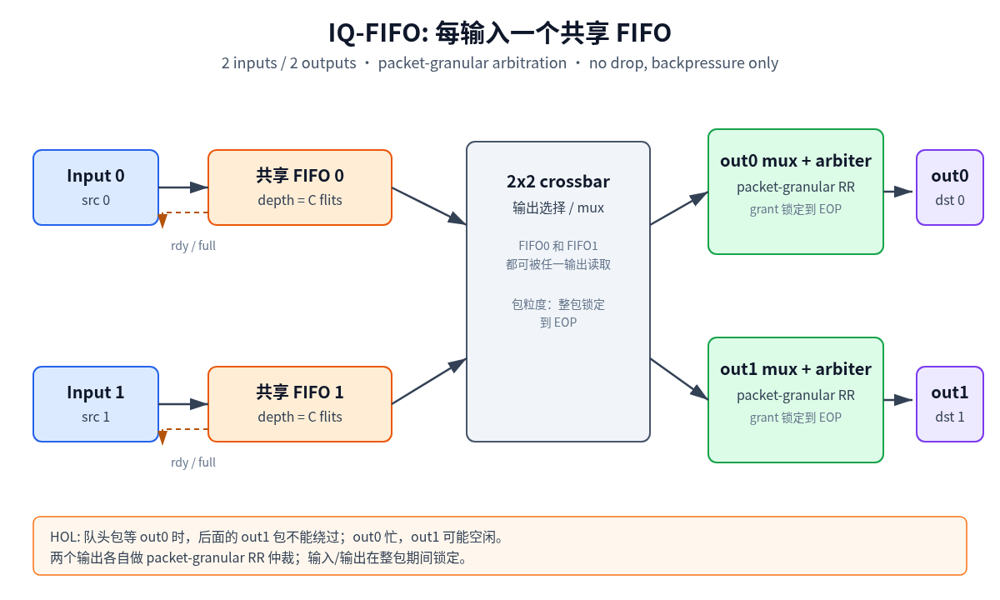
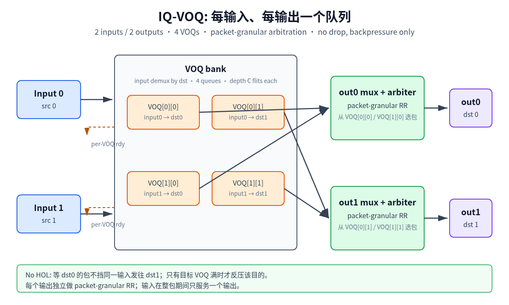
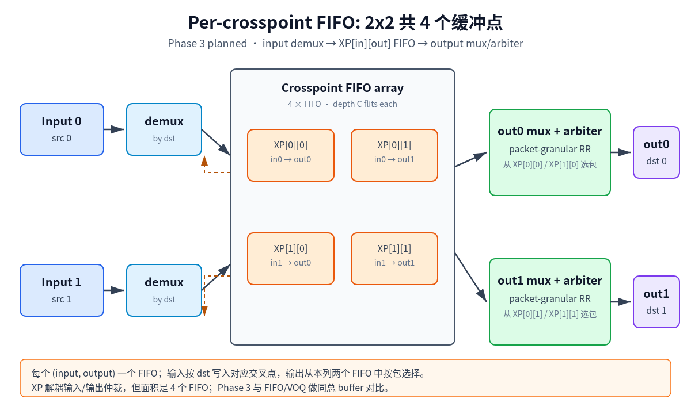
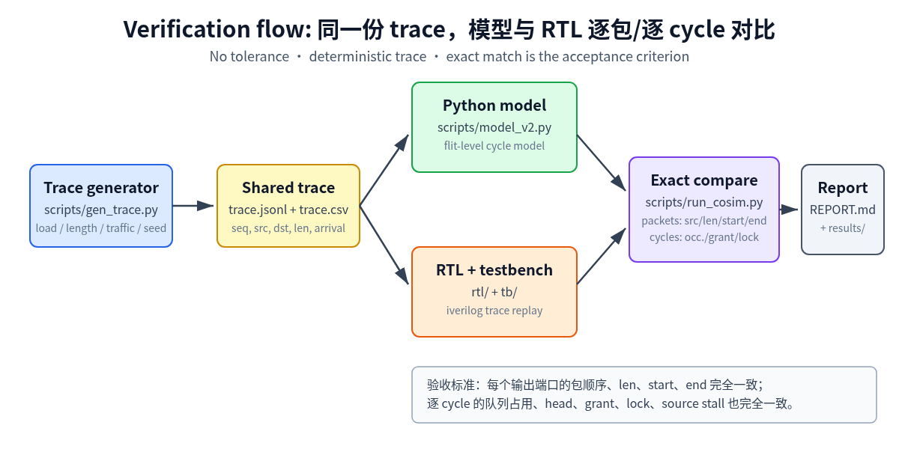

# 2x2 Crossbar: FIFO vs VOQ

一个 cycle-accurate 的 2x2 packet crossbar 实验：比较共享输入 FIFO 与 per-destination VOQ 在 no-drop / backpressure 下的吞吐、延迟和 HOL blocking。

> ⚠️ 2026-11-03 计量口径已修正：`SOURCE_GAP=0`（背靠背源端）+ 逐 flit 握手吞吐 +
> HOL/竞争拆分。下方 Phase 1/2/3 的旧数字仍使用 `SOURCE_GAP=1` 和包完成口径，
> 不能直接引用；重跑结果见 `docs/progress.md` §9。

> Phase 1：模型与 RTL 已逐包、逐 cycle 对齐，结论见 [REPORT.md](REPORT.md)。
> Phase 2：把 per-queue capacity 作为正交变量做全因子矩阵，结论见
> [reports/phase2.md](reports/phase2.md)。Phase 1 产物保持不变。
> Phase 3：实现 per-crosspoint FIFO（XP），并与 FIFO/VOQ 做 core matrix 精确对比，
> 结论见 [reports/phase3.md](reports/phase3.md)。
> 2026-11-03 修正口径（`SOURCE_GAP=0`、逐 flit 握手、HOL 拆分、输出反压）：
> Phase 1 见 [reports/phase1_gap0.md](reports/phase1_gap0.md)，Phase 2/3 数据见
> [reports/phase2_gap0.md](reports/phase2_gap0.md) 和
> [reports/phase3_gap0.md](reports/phase3_gap0.md)。









## 结论速览

Phase 1（固定总 buffer 64）：

- load 0.5：FIFO 与 VOQ 都能跟上，利用率约 0.489
- load ≥0.8：FIFO 被 HOL 卡在约 0.716–0.718；VOQ 约 0.789–0.813
- FIFO 的 HOL rate 约 46–47%；VOQ 为 0
- 等总 buffer 64 flits 下比较，不是靠增加存储赢

Phase 2（容量正交，1152 runs）：

- 1152/1152 全部 exact；384 cells、192 strata
- VOQ 利用率更好 112/192，FIFO 更好 10/192，持平 70/192
- 平均增益 +2.69pp；容量越大越明显：cap 4/8/16/32 为
  +0.88 / +2.40 / +3.50 / +3.99pp
- 只有较高负载明显：load 0.5 基本持平，0.8/0.95/1.0 为
  +2.85 / +3.95 / +3.95pp
- fixed1 全部持平；bimodal1-8 增益最大（+4.45pp）
- 等总 buffer 16/32/64 flits 的增益为 +0.19 / +2.25 / +3.55pp

Phase 3（XP core matrix，144 runs）：

- 144/144 model/RTL exact；XP 与 VOQ 在 48 个 seed-pair 上所有指标完全相同
- 等每队列深度时 XP 相对 FIFO：cap 4/8/16/32 为
  +1.87 / +4.64 / +6.31 / +6.85pp；但 XP 总 buffer 是 FIFO 的 2 倍，不能直接算赢
- 等总 buffer 时 XP 相对 FIFO：16/32/64 flits 为
  +0.58 / +3.99 / +6.61pp；16-flit 点收益很小，32/64-flit 点才明显
- load 0.5 基本持平；load 0.8/0.95/1.0 在等每队列容量口径下为
  +5.82 / +6.62 / +7.25pp
- XP-only 在 2x2、单 outstanding source 下与当前 IQ-VOQ 可观测行为等价；
  它是同一组 4 个 per-(src,dst) 队列的物理放置，不是本轮的新吞吐机制

## 实验设定

- 2 输入 / 2 输出，1 flit/input/cycle，1 flit/output/cycle
- 包长 uniform random 1–8 flits
- 包粒度仲裁，整包锁定到 EOP
- 不丢包：队列满拉低 `rdy`，源端 stall
- 总 buffer 64 flits：
  - FIFO：2 × 32
  - VOQ：4 × 16
- 输出 RR 仲裁；uniform destination；load 0.5 / 0.8 / 0.95 / 1.0

## Phase 2：容量作为正交变量

Phase 2 固定 2x2、包粒度仲裁、no-drop，把容量按 **per-queue** 计：

- queue type：`fifo` / `voq`
- capacity per queue：4 / 8 / 16 / 32 flits（0.5 / 1 / 2 / 4 max packets）
- load：0.5 / 0.8 / 0.95 / 1.0
- packet length：`fixed1` / `fixed8` / `uniform1-8` / `bimodal1-8`（50/50）
- traffic：`uniform` / `hotspot` / `bursty`
- seeds：1 / 2 / 3

共 `2 × 4 × 4 × 4 × 3 × 3 = 1152` runs。先跑 core capacity curve（capacity ×
load × type，`uniform1-8` + `uniform`，96 runs），再跑完整矩阵。

RTL/TB 的队列深度是编译期参数：FIFO `DEPTH`、VOQ `VOQ_DEPTH`。每个
`(type, capacity)` 只编译一个 binary，所有 load/length/traffic/seed 复用。

```bash
python3 scripts/run_matrix.py --workdir ~/Temp/phase2 --outdir results/phase2
```

结果文件见 [results/phase2/](results/phase2/)，完整报告见
[reports/phase2.md](reports/phase2.md)。

## Phase 3：per-crosspoint FIFO（XP）

XP 在 2x2 中放 4 个 FIFO：`xp[src][dst]`。输入 demux 按 `dst` 写入目标
crosspoint，输出从本列两个 XP FIFO 中按包粒度 RR 选包，整包锁定到 EOP；
目标 FIFO 满时只反压、不丢包。XP-only 不另设输入队列，源端一次只持有一个包。

Core matrix：

- queue type：`fifo` / `voq` / `xp`
- capacity per queue：4 / 8 / 16 / 32 flits
- load：0.5 / 0.8 / 0.95 / 1.0
- packet length：`uniform1-8`；traffic：`uniform`；seeds：1 / 2 / 3

共 `3 × 4 × 4 × 3 = 144` runs。每个 `(type, capacity)` 编译一次，所有
load/seed 复用 binary；每次 run 同时跑 Python cycle model 和 RTL，逐包 +
逐 cycle 比较。

容量口径：

- FIFO 总 buffer = `2 × C_fifo`
- VOQ / XP 总 buffer = `4 × C_4q`
- 等总 buffer 比较用 `C_4q = C_fifo / 2`：FIFO 8/16/32 对 XP/VOQ 4/8/16

```bash
python3 scripts/run_phase3.py --workdir ~/Temp/phase3 --outdir results/phase3
python3 scripts/compare_xp_voq.py --traces-dir ~/Temp/phase3_directed \
  --depths 4,8,16,32 --cycles 2200 --workdir ~/Temp/phase3_equiv \
  --out results/phase3/xp_voq_rtl_equivalence.json
```

结果文件见 [results/phase3/](results/phase3/)，完整报告见
[reports/phase3.md](reports/phase3.md)。

## 快速开始（Phase 1）

```bash
python3 scripts/gen_trace.py --out /tmp/trace.jsonl --csv-out /tmp/trace.csv \
  --load 0.8 --cycles 4000 --seed 1

python3 scripts/run_cosim.py \
  --trace-jsonl /tmp/trace.jsonl --trace-csv /tmp/trace.csv \
  --cycles 4000 --warmup 500 \
  --dut fifo --mode fifo --total-buffer 64 --compile \
  --outdir /tmp/cosim_fifo
```

把 `--dut fifo --mode fifo` 换成 `--dut voq --mode voq` 即可跑 VOQ。

批量 sweep：

```bash
python3 scripts/run_sweep.py \
  --loads 0.5,0.8,0.95,1.0 --seeds 1,2,3 \
  --cycles 4000 --warmup 500 \
  --mode fifo --dut fifo \
  --outdir /tmp/sweep_fifo \
  --json-out results/phase1/fifo_summary.json
```

## 目录

- `scripts/model_v2.py`：flit 粒度 cycle model
- `scripts/gen_trace.py`：模型/RTL 共用 trace（Phase 2 增加 length / traffic 模式）
- `scripts/gen_directed.py`：27 个定向验证 case
- `scripts/run_cosim.py`：逐包 + 逐 cycle 精确对比，支持编译期 depth
- `scripts/run_sweep.py`：Phase 1 load/seed sweep
- `scripts/run_matrix.py`：Phase 2 全因子矩阵驱动
- `scripts/analyze_phase2.py`：Phase 2 聚合、effect 分层、等总 buffer 提取
- `scripts/run_phase3.py`：Phase 3 FIFO/VOQ/XP core matrix 驱动
- `scripts/analyze_phase3.py`：Phase 3 配对 delta、等总 buffer、XP/VOQ 等价汇总
- `scripts/compare_xp_voq.py`：XP 与 VOQ 两套 RTL 的逐包/逐 cycle 等价检查
- `rtl/`：FIFO、VOQ、XP 三套参数化 RTL（遵循 rtl-developer 规范）
- `sva/`：RTL 协议断言（FIFO/VOQ/XP）
- `tb/`：trace replay + 调试 CSV（顶层 `DEPTH` 参数）
- `vendor/cbb/`：复用的 CBB（fifo_sync、arbiter_rr、dff 等）
- `docs/architecture/2x2-crossbar.md`：架构、接口、时序契约
- `docs/figures/`：FIFO/VOQ/XP/验证流程图，SVG 源 + PNG
- `scripts/`：trace、模型、co-sim、sweep、Phase 2/3 矩阵与分析脚本
- `REPORT.md`：Phase 1 完整报告
- `reports/phase2.md`：Phase 2 完整报告
- `reports/phase3.md`：Phase 3 完整报告
- `results/phase1/`：Phase 1 sweep 汇总
- `results/phase2/`：Phase 2 raw summary、聚合 JSON、绘图 CSV
- `results/phase3/`：Phase 3 core matrix、等总 buffer、XP/VOQ 等价汇总

## 验证标准

模型和 RTL 使用同一份 trace；`scripts/run_cosim.py` 按输出端口完成顺序比较
`(src, len, start, end)`，并可逐 cycle 比较 occupancy、head、grant、lock、
source stall。FIFO/VOQ/XP 都走同一套比较；任何差异直接报错，不使用统计容差。
`scripts/compare_xp_voq.py` 另外做 XP RTL 与 VOQ RTL 的逐包/逐 cycle 相等检查。

## License

新代码使用 MIT；`vendor/cbb/` 复用 `ttoms/cbb_proj` 的 CBB，归属和说明见 `vendor/cbb/NOTICE.md`。
