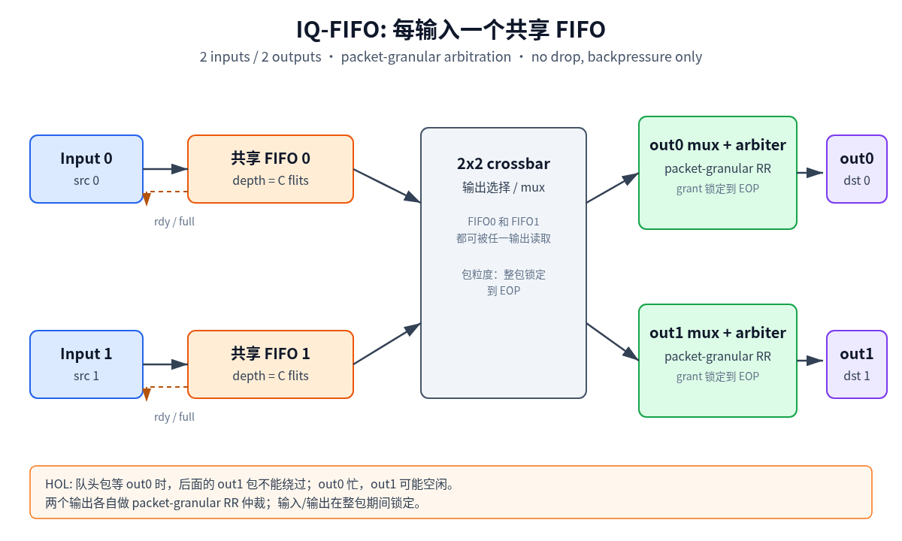
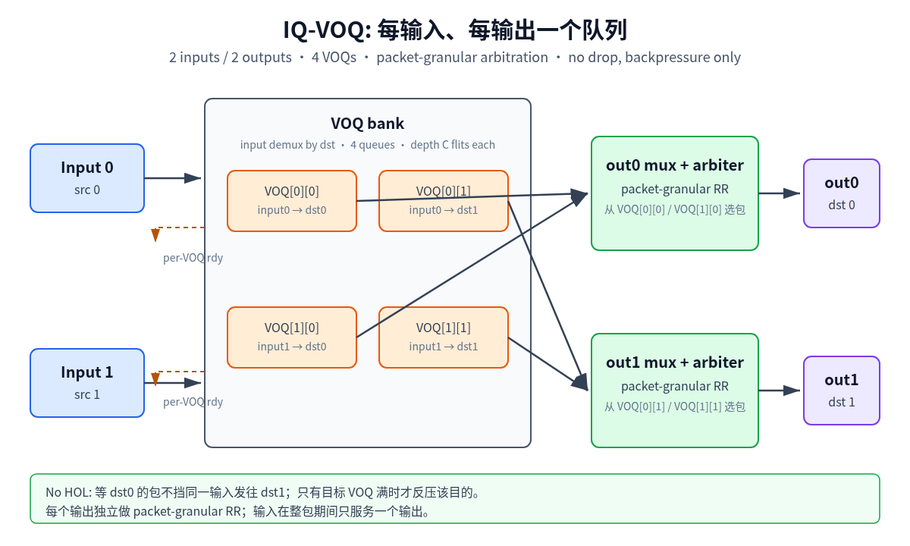
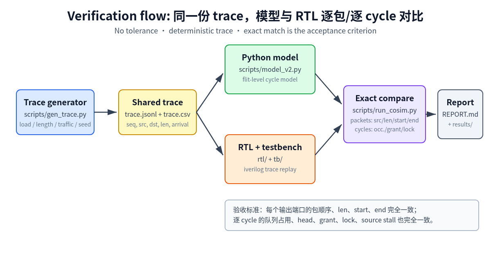

# Phase 1 — 2x2 Crossbar: FIFO vs VOQ
> ⚠️ 2026-11-03 计量口径修正：本报告数字使用 `SOURCE_GAP=1` / 包完成吞吐口径，
> 已被 `SOURCE_GAP=0` + 逐 flit 握手口径取代。修正后的 Phase 1/2/3 数字见
> `docs/progress.md` §9；在报告重写前不要引用本页吞吐/HOL/延迟数字。


> 日期：2026-11-02
> 范围：2 输入 / 2 输出、包长 1–8 flits、包粒度仲裁、无丢包、只反压。
> 结论先行：FIFO 的瓶颈是 HOL blocking；在相同总 buffer 下，VOQ 把负载 ≥0.8 时的归一化利用率从约 **0.716** 提升到约 **0.813**。

## 1. 问题

一个 2x2 的片上 crossbar，每个输入随机访问任一输出，包长随机 1–8 flits，按包粒度仲裁。两个输入可能同时访问同一个输出，失败方等待，不丢包。

要回答的问题：

- 共享 FIFO 的 head-of-line blocking 会损失多少吞吐？
- 改成每输入、每输出一个 VOQ，能恢复多少？
- 在相同总 buffer、相同 trace、相同仲裁策略下，差异是否真的来自队列结构？

## 2. 实验设计

固定条件：

- 2 输入 / 2 输出，1 flit/输入/cycle，1 flit/输出/cycle
- 包长 uniform random 1–8 flits
- 包粒度仲裁：一个包获得输出后，占用输入和输出直到 EOP
- 不丢包：队列满时拉低 `rdy`，源端保持 `vld` 等待
- 总 buffer = 64 flits
  - FIFO：每输入 32 flits（2 × 32）
  - VOQ：每个输入-输出队列 16 flits（4 × 16）
- 仲裁：每输出 round-robin；output 0 在冲突时优先，output 1 的请求避让
- 流量：uniform destination；load 0.5 / 0.8 / 0.95 / 1.0；每点 3 个 seed
- 统计：4000 cycles，前 500 cycles warmup；吞吐按 warmup 后 3500 cycles 计算

对比组：

- `fifo`：每个输入一个共享 FIFO
- `voq`：每个输入、每个输出一个独立队列

关键控制：

- 同总 buffer bit 数，不是同每队列深度
- 同 trace、同 seed、同输出仲裁、同源端反压模型
- 模型与 RTL 逐包、逐 cycle 对比，不使用统计容差

## 3. 实现

### 3.1 模型

`scripts/model_v2.py` 是 flit 粒度的 cycle model：

- 源端每 cycle 写 1 个 flit，包长 L 占用 L 个 cycle，最后还有 1 个 cycle turnaround
- 写接纳只看 cycle 开始时的队列占用；同 cycle 读出不能给写腾位置
- 仲裁只看 cycle 开始时的 head；本 cycle 写入的 flit 下一 cycle 才可见
- 多 flit 包锁定输入/输出直到 EOP
- FIFO 和 VOQ 共用同一套时序语义

### 3.2 RTL

- `rtl/xbar_2x2_fifo.sv`：2 个共享输入 FIFO，每输出一个 packet-granular RR 仲裁
- `rtl/xbar_2x2_voq.sv`：4 个 VOQ，输入按 dst demux，每输出 packet-granular RR 仲裁
- `tb/xbar_2x2_fifo_tb.sv`、`tb/xbar_2x2_voq_tb.sv`：trace replay、packets CSV、逐 cycle 调试 CSV
- RTL 遵循 `rtl-developer` 规范：`dff/dffr` 显式状态、端口预处理、独立 `.sva`、quality gate + align





### 3.3 复用的 CBB

- `fifo_sync`
- `arbiter_rr`
- `pri_tree` / `suf_or`（arbiter 内部）
- `bin2ohot`
- `dff` / `dffr`

这些 CBB 已 vendored 到 `vendor/cbb/rtl/`，仓库不依赖本机其他路径。

### 3.4 参数

- `FLIT_W`
- `DEPTH`（FIFO）/ `VOQ_DEPTH`（Phase 1 分别为 32 / 16；Phase 2 编译期按 4/8/16/32 覆盖）
- `ARB_TYPE`：RR
- `GRANT_LATENCY`：组合 grant
- `MAX_PKT_LEN=8`
- `total_buffer=64`（Phase 1）

## 4. 验证方法

### 4.1 共享 trace

`scripts/gen_trace.py` 生成 `trace.jsonl` 和 `trace.csv`，模型和 RTL TB 读同一份：

```json
{"seq": 0, "src": 0, "dst": 1, "len": 4, "arrival": 3}
```

源端按 trace 顺序提供包，`vld` 保持到 `rdy`，队列满就 stall，不丢包。

### 4.2 逐包 / 逐 cycle 对比

`scripts/run_cosim.py` 同时运行模型和 RTL：

- 按输出端口的完成顺序比较 `(src, len, start, end)`
- 可选逐 cycle 比较队列 occupancy、head、grant、lock、source write/stall
- 任何一项不一致直接报错，不使用容差



### 4.3 覆盖

- 原 2000-cycle、load=0.5 trace：434 包 / 1933 flits
- 27 个定向 case：单包四组合、同目的冲突、最大包长、FIFO/VOQ 打满、HOL、RR、背靠背到达
- load sweep：0.5 / 0.8 / 0.95 / 1.0 × 3 seeds
- 过载：1.2 / 1.5，确认只反压、不丢包

## 5. 结果

等总 buffer 64，uniform destination，包长 1–8：

- load 0.5
  - FIFO：utilization 0.489，avg pkt latency 10.77，HOL rate 0.024，output idle 0.511
  - VOQ：utilization 0.489，avg pkt latency 10.32，HOL rate 0.000，output idle 0.511
- load 0.8
  - FIFO：utilization 0.716，avg pkt latency 240.26，HOL rate 0.466，output idle 0.285
  - VOQ：utilization 0.789，avg pkt latency 78.31，HOL rate 0.000，output idle 0.211
- load 0.95
  - FIFO：utilization 0.718，avg pkt latency 498.27，HOL rate 0.466，output idle 0.282
  - VOQ：utilization 0.813，avg pkt latency 308.65，HOL rate 0.000，output idle 0.187
- load 1.0
  - FIFO：utilization 0.716，avg pkt latency 586.47，HOL rate 0.469，output idle 0.284
  - VOQ：utilization 0.813，avg pkt latency 400.55，HOL rate 0.000，output idle 0.187

所有对比组的模型/RTL 都是 exact match：逐包 0 差异，逐 cycle 调试字段 0 差异。

## 6. 结论

- load 0.5 时，FIFO 和 VOQ 都能跟上 offered load，利用率约 0.489，差异很小
- load ≥0.8 时，FIFO 被 HOL 卡在约 0.716–0.718；VOQ 达到约 0.789–0.813
- FIFO 的 HOL rate 约 46–47%；VOQ 为 0
- VOQ 也没有到 100%，原因是输入端口一次只能服务一个包，长包会占用输入；有限 buffer 也会反压
- 在相同总 buffer 下，队列结构本身就是主要差异，不是“VOQ 多给了内存”

## 7. 限制

- 当前 TB 固定 `out_rdy=2'b11`，没有覆盖下游输出反压
- 只有 uniform destination 和随机包长；bursty、固定包长、双峰包长还没接入
- 没有 XP per-crosspoint、OQ、CIOQ
- RTL packets CSV 没有显式 `seq/dst`，包身份靠“每输入保序 + 每端口完成顺序 + 逐 cycle 比较”
- Phase 1 的 RTL TB 使用固定 64 flits；Phase 2 已改为编译期 `DEPTH` 参数，用 `--depth` 指定 per-queue 容量

## 8. 复现

```bash
# 依赖：Python 3.10+、iverilog 11+
python3 scripts/gen_trace.py --out /tmp/trace.jsonl --csv-out /tmp/trace.csv \
  --load 0.8 --cycles 4000 --seed 1

python3 scripts/run_cosim.py \
  --trace-jsonl /tmp/trace.jsonl --trace-csv /tmp/trace.csv \
  --cycles 4000 --warmup 500 \
  --dut fifo --mode fifo --total-buffer 64 --compile \
  --outdir /tmp/cosim_fifo

python3 scripts/run_cosim.py \
  --trace-jsonl /tmp/trace.jsonl --trace-csv /tmp/trace.csv \
  --cycles 4000 --warmup 500 \
  --dut voq --mode voq --total-buffer 64 --compile \
  --outdir /tmp/cosim_voq
```

批量 sweep 见 `scripts/run_sweep.py`，原始汇总在 `results/phase1/`。

## 9. 下一阶段

Phase 2：

- 增加可配置的 `out_rdy` 反压序列
- 增加 bursty / 固定包长 / 双峰包长矩阵
- RTL packets CSV 增加显式 `seq/dst`，增强包身份校验
- 保持逐包、逐 cycle exact 的验收标准

Phase 3：

- XP per-crosspoint（2x2 共 4 个 FIFO）
- OQ / CIOQ
- 完整 FIFO 位置对比 + 面积代理

Phase 4：

- 最终汇总、README、复现实验、对外可读总结
