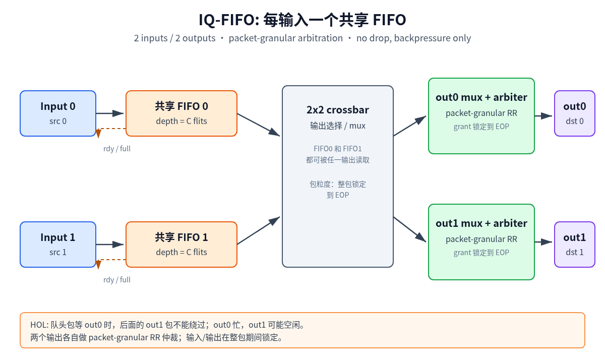
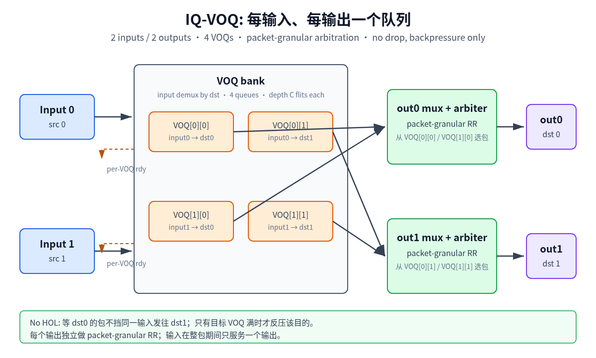
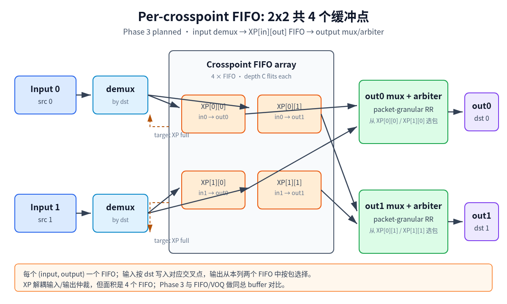

# 2x2 Packet Crossbar — Architecture Spec (P0)

> 状态：v0.1，2026-11-02。先定接口、时序、模型/RTL 对齐标准，再写 RTL。
> 范围：2 输入 / 2 输出，包长 1–8 flits，包粒度仲裁，不丢包，只反压。

## 1. 固定前提

- 2 个输入端口、2 个输出端口。
- 每个包有 `src`、`dst`、`len`（1–8 flits），包内 flit 连续传输。
- 包粒度仲裁：一个包获得输出后，占用该输出和对应输入直到 EOP，不允许 flit 交织。
- 不丢包：队列满时拉低 `rdy`，源端保持 `vld` 等待。
- 包按 flit 传输，每拍每输入最多 1 flit，每输出最多 1 flit。
- 单时钟域；复位异步置位、同步释放。

## 2. FIFO 位置

### 2.1 Input FIFO（IQ-FIFO）

每个输入一个共享 FIFO，所有目的共用。队头包等输出时，后面的包不能绕过，形成 HOL blocking。



### 2.2 Input VOQ（IQ-VOQ）

每个输入、每个输出一个队列；2x2 共 4 个 VOQ。输入调度器选择一个非空且目标输出可用的 VOQ，避免队头包阻塞其他目的。



### 2.3 Output FIFO（OQ）

每个输出一个 FIFO，位于输出 mux 之后。输入侧通常只有 skid/reg_slice；输出 FIFO 吸收下游反压和突发。输出 FIFO 不能消除输入侧 HOL，需与输入队列组合时明确是 CIOQ。

### 2.4 Per-crosspoint FIFO（XP）

每个 input-output 交叉点一个 FIFO；2x2 共 4 个 crosspoint FIFO：



- 输入 demux 按包的 `dst` 把整包写入对应 XP FIFO。
- 输出 mux 从该输出的两个 XP FIFO 中按包粒度仲裁。
- 输入写入受目标 XP FIFO 反压；输出读出受下游反压。
- XP-only 变体不另设输入队列：输入一次只持有一个包；目标 XP FIFO 满时输入 stall。
- 可选 `XP+VOQ`：输入 VOQ 在 XP 之前，输入可选择有空间的 XP FIFO；v1 不做，先做 XP-only，避免一次引入两层队列。

## 3. 接口

### 3.1 Flit

```text
vld
rdy
data[FLIT_W-1:0]
sop
eop
```

- `vld` 与 `data/sop/eop` 同拍有效；`vld` 不依赖 `rdy`。
- `sop=1` 表示包首 flit；`eop=1` 表示包尾 flit；单 flit 包 `sop=eop=1`。
- `len` 不单独传输，由 `sop` 到 `eop` 计数得到；需要时可在包头附带 `len`，v1 不使用。
- 输入侧额外有 `dst`，在 `sop` 拍有效；输出侧不需要 `dst`。

### 3.2 端口

```text
in_flit[2]
out_flit[2]
```

每个端口独立 `vld/rdy`。一个输入在整包期间只能服务一个输出；一个输出在整包期间只能服务一个输入。

## 4. 仲裁与时序契约

- 每输出一个 packet-granular arbiter。
- 仲裁只在 `sop` 拍发生；grant 后锁定到 `eop`。
- 输出被占用期间，其他输入对该输出的请求保持等待，不丢包。
- 输入被占用期间，不能开始发往另一个输出的新包。
- `ARB_LATENCY` 参数：
  - 0：组合 grant，当拍可开始传输；
  - 1：grant 寄存一拍，下一拍开始传输。
- 队列读写延迟：
  - `fifo_sync` 为同步 FIFO，读写各一拍语义；
  - 模型必须按 RTL 的 `rdy/vld` 时序建模，不能只按队列长度估算。
- 反压路径：
  - 下游 `rdy=0` -> 输出 mux 停止读 XP FIFO；
  - XP FIFO 满 -> 输入 demux 的 `rdy=0`；
  - 输入保持当前包，不切换目的，直到写入完成。

## 5. 模型 / RTL 对齐契约

### 5.1 共享 trace

Python 生成 `trace.jsonl`，每行一个包：

```json
{"seq": 0, "src": 0, "dst": 1, "len": 4}
```

- 源端按 trace 顺序提供包；`vld` 保持到 `rdy`，不丢包。
- 模型和 RTL TB 读取同一份 trace、同一 seed、同一初始状态。

### 5.2 观测输出

模型和 RTL 都输出 `packets.csv`：

```text
seq,src,dst,len,start_cycle,end_cycle,out_port
```

- `start_cycle`：包首 flit 被输出端口接受的第一拍；
- `end_cycle`：包尾 flit 被输出端口接受的最后一拍；
- 每个输出端口分别按完成顺序比较。
- 可选 `cycles.csv`：每拍每个队列的 `occupancy`、每个输出的 `grant_src`，用于定位不一致。

### 5.3 对齐标准

- 确定性 trace 下，`packets.csv` 的 `seq` 顺序、`start_cycle`、`end_cycle` 完全一致。
- 随机 trace 下，包级完成顺序和 cycle 完全一致；统计指标自然一致。
- 若 RTL 增加流水级，模型必须加同样的 `ARB_LATENCY` / `SLICE_STAGES`，不允许用容差掩盖。
- 不一致时先比 `cycles.csv` 的 grant/occupancy，定位是仲裁优先级、FIFO 时序还是反压路径。

### 5.4 定向 case

- 单包，4 种 src/dst 组合。
- 两输入同时打同一输出，包长 1/1、8/1、8/8。
- 两输入打不同输出，背靠背。
- 目标 XP FIFO 满，输入 stall。
- 下游反压，输出 mux stall。
- 单 flit 包、最大 8 flit 包。
- 随机 1000 包 × 10 seeds。

## 6. RTL 模块

公共：

- `xbar_2x2_top`：参数选择 IQ_FIFO / IQ_VOQ / OQ / XP。
- `pkt_fifo`：带 `sop/eop` 的 FIFO 包装，内部用 `fifo_sync` 或 `fifo_sync_af`。
- `pkt_arbiter`：包粒度仲裁，grant 锁定到 EOP；内部用 `arbiter_wrapper`。
- `xbar_input_demux`：按 `dst` 写入 IQ/VOQ/XP。
- `xbar_output_mux`：按 grant 选择输入/XP FIFO 的 flit。
- `pkt_counter`：包内 flit 计数、EOP 检查。
- `skid` / `reg_slice`：时序打拍、反压吸收。

变体：

- `iq_fifo`：2 个输入 FIFO + 输出 mux。
- `iq_voq`：4 个 VOQ + 输入调度 + 输出 mux。
- `oq`：输入 skid + 输出 mux + 2 个输出 FIFO。
- `xp`：4 个 crosspoint FIFO + 输入 demux + 输出 mux。

TB：

- `xbar_tb`：驱动 trace，收集 `packets.csv` / `cycles.csv`。
- `scoreboard`：与模型输出比较，报第一个不一致的包和 cycle。

## 7. CBB 映射

直接复用：

- `fifo_sync` / `fifo_sync_af`
- `arbiter_wrapper` / `arbiter_rr` / `arbiter_pri`
- `reg_slice`
- `counter`
- `dff` / `dffr`

可能需要：

- `bin2ohot` / `ohot2bin`
- `arbmux` / `strmux`（先确认 packet 锁定语义能否直接复用）

项目专用，验证后再考虑提升为 CBB：

- `pkt_fifo`
- `pkt_arbiter`
- `voq_bank`
- `crosspoint_fifo_array`

## 8. 参数

- `N=2`（RTL 可参数化，但 v1 只验证 2）
- `FLIT_W`
- `MODE`：IQ_FIFO / IQ_VOQ / OQ / XP
- `IQ_DEPTH`：输入 FIFO flit 深度
- `VOQ_DEPTH`：每个 VOQ flit 深度
- `XP_DEPTH`：每个 crosspoint FIFO flit 深度
- `OQ_DEPTH`：输出 FIFO flit 深度
- `ARB_TYPE`：RR / FIXED
- `GRANT_LATENCY`：0 / 1
- `SLICE_MODE`：bypass / forward / backward / full
- `MAX_PKT_LEN=8`
- `PKT_LEN_W=4`
- `ORDER_MODE`：per-destination order / global order
- `TRACE_FILE`
- `SEED`

## 9. 等缓冲比较

VOQ 和 XP 都是 4 个队列，FIFO 是 2 个队列。比较时必须等总 bit：

- FIFO：2 × `IQ_DEPTH`
- VOQ：4 × `VOQ_DEPTH`
- XP：4 × `XP_DEPTH`

令总 flit 容量为 `B`：

- `IQ_DEPTH = B / 2`
- `VOQ_DEPTH = B / 4`
- `XP_DEPTH = B / 4`

同时报告“每队列等深”和“总缓冲等 bit”两组结果，避免 VOQ/XP 靠多一倍存储赢。

## 10. 实验矩阵

v1：

- IQ_FIFO vs IQ_VOQ，等总 buffer，RR，uniform 1–8，load 0.5/0.8/0.95/1.0
- 包长固定 1 / 固定 8 / uniform 1–8 / 双峰 1/8
- 定向冲突 + 随机 trace

v2：

- 加入 XP（per-crosspoint 4 FIFO），同总 buffer 对比 IQ_FIFO / IQ_VOQ
- 可选 OQ / CIOQ
- 过载 1.2/1.5，确认只反压不丢包

指标：

- 饱和吞吐、归一化利用率
- 平均/p99 包延迟
- 源端 stall rate
- 队列平均/最大占用
- HOL 周期、输出空闲周期
- 每输入/输出吞吐、Jain fairness
- FIFO bit 数、仲裁逻辑规模

## 11. 阶段

- P0：本文档 + 接口/时序契约（当前）
- P1：模型 v2（no-drop + backpressure）+ trace 生成器 + 指标
- P2：RTL IQ_FIFO + TB + 模型/RTL 对齐
- P3：RTL IQ_VOQ + 对齐 + 对比
- P4：RTL XP per-crosspoint + 对齐 + 对比
- P5：OQ/CIOQ（可选）+ 实验矩阵 + 报告

## 12. 风险

- XP-only 没有输入队列时，输入目标 XP FIFO 满会 stall，仍可能产生输入侧 HOL；需要与 IQ_VOQ 区分。
- XP 有 4 个队列，面积/时序成本高于 FIFO；必须同时报告等总 buffer 和等每队列深度。
- 包粒度 grant 锁定期间，输出无法切换，长包会拉高其他输入的等待时间。
- VOQ/XP 允许跨目的重排；如果 SoC 要求全局严格保序，需要额外约束，结论会不同。
- 模型和 RTL 的反压时序差一拍，所有 cycle 结果都会错位；必须先把 `ARB_LATENCY`、FIFO 读写语义定死。
