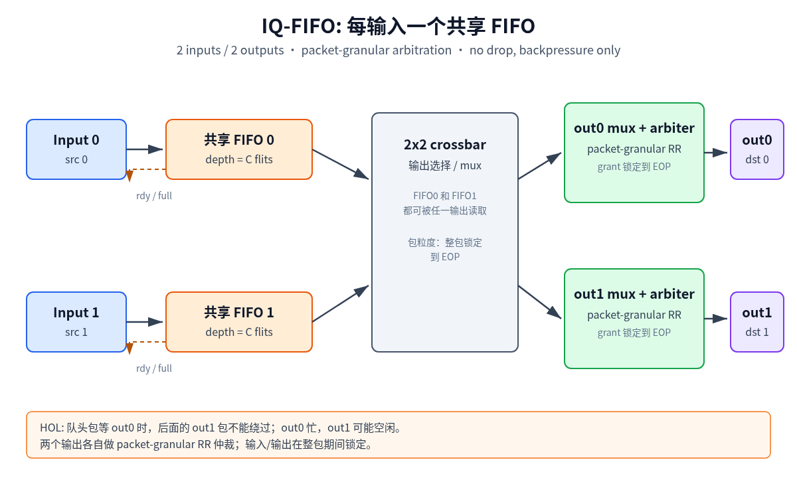
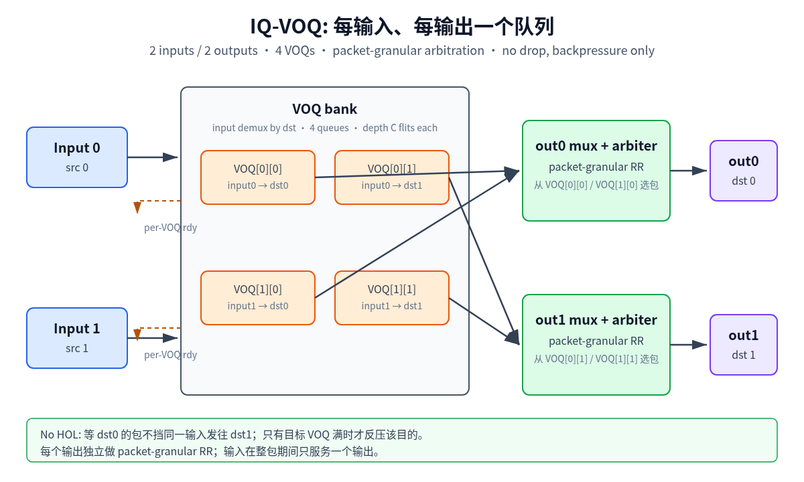
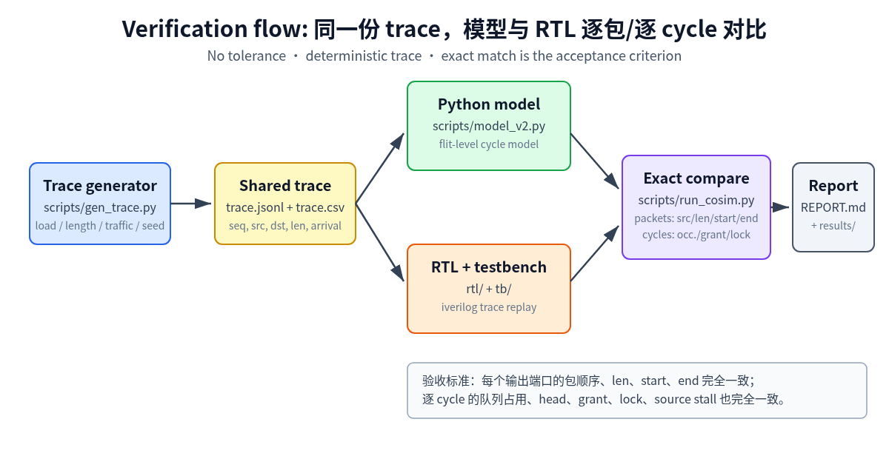

# Phase 2 — 容量作为正交变量：2x2 Crossbar FIFO vs VOQ

> 日期：2026-11-03（矩阵跨 11/02–11/03）
> 实验目录：`experiment/1-2x2-crossbar-fifo-vs-voq`
> Phase 1 报告：[../REPORT.md](../REPORT.md)（Phase 1 产物保持不变）
> 原始数据与绘图数据：[../results/phase2/](../results/phase2/)

## 0. 结论速览

- 1152 / 1152 runs 全部 exact：384 个 cell、192 个 strata，0 mismatch。
- 全体 strata：VOQ 利用率更好 112 个，FIFO 更好 10 个，持平 70 个；
  VOQ − FIFO 平均 **+2.69 个百分点**，中位数 +0.43pp，最大 +13.37pp。
- 容量越大，VOQ 优势越明显：cap 4/8/16/32 的平均利用率增益分别为
  **+0.88 / +2.40 / +3.50 / +3.99pp**。
- 只在较高负载出现优势：load 0.5 基本持平；load 0.8/0.95/1.0 分别
  **+2.85 / +3.95 / +3.95pp**。
- 包长分布很关键：fixed1 全部持平；bimodal1-8、uniform1-8、fixed8 的增益
  分别为 **+4.45 / +3.67 / +2.65pp**。
- 等总 buffer 下 VOQ 仍然更好：16/32/64 flits 的增益为
  **+0.19 / +2.25 / +3.55pp**；buffer 越大，优势越明显。
- 延迟：VOQ 在 132/192 个 strata 更低，FIFO 在 0 个更低；平均包延迟
  平均低约 59 cycles，p99 低约 107 cycles。
- 结论：VOQ 不是“任何情况都更快”，但在有 HOL 的高负载、变长包、较深
  队列下稳定更好；fixed1 和 hotspot 下优势很小或消失。

## 1. 问题

Phase 1 固定总 buffer = 64 flits（FIFO 2×32，VOQ 4×16），只回答了
“同总 buffer 下 FIFO 与 VOQ 差多少”，没有回答：

- 每队列容量本身如何影响吞吐、延迟和 HOL？
- FIFO 与 VOQ 的差异是否依赖容量、负载、包长和流量模式？
- 在相同总 buffer 下，VOQ 的优势是否仍成立？在很小的总 buffer 下是否反转？

Phase 2 把 **per-queue capacity** 变成正交变量，做全因子对照。容量按每个队列计：
4 / 8 / 16 / 32 flits，对应 0.5 / 1 / 2 / 4 个最大包（最大包长 8 flits）。
因此：

- FIFO：每个输入一个共享队列，总容量 = 2 × C
- VOQ：每个 (input, output) 一个队列，共 4 个，总容量 = 4 × C

“同 per-queue capacity”并不等于“同总 buffer”。等总 buffer 的比较在第 5.4 节
从同一批数据中重新提取，不额外重跑。

## 2. 变量矩阵

| 维度 | 取值 |
|---|---|
| queue type | `fifo` / `voq` |
| capacity per queue | 4 / 8 / 16 / 32 flits（0.5 / 1 / 2 / 4 max packets） |
| load（per-input offered flit rate） | 0.5 / 0.8 / 0.95 / 1.0 |
| packet length mode | `fixed1` / `fixed8` / `uniform1-8` / `bimodal1-8`（50/50） |
| traffic | `uniform` / `hotspot` / `bursty` |
| seed | 1 / 2 / 3 |

全因子规模：`2 × 4 × 4 × 4 × 3 × 3 = 1152` runs。

执行顺序：

1. **Core capacity curve**：capacity × load × type，固定 `uniform1-8` +
   `uniform` traffic，共 `2 × 4 × 4 × 3 = 96` runs。
2. **完整矩阵**：其余 1056 runs，最后得到 `2 × 4 × 4 × 4 × 3 = 384` 个
   (type, capacity, load, length, traffic) cell，每个 cell 3 个 seed。

固定条件（与 Phase 1 相同）：

- 2 inputs / 2 outputs，每输入每 cycle 最多 1 个 flit，每输出每 cycle 1 个 flit
- packet-granular arbitration，整包锁定 input/output 直到 EOP
- no-drop：队列满拉低 `rdy`，源端 stall
- 每输出 round-robin；output 0 在冲突时优先
- 下游始终 ready（`out_rdy = 2'b11`），本阶段不注入输出反压
- 4000 cycles，前 500 cycles warmup，指标按后 3500 cycles 统计

## 3. Trace 模型与源端契约

### 3.1 包长模式

| mode | 分布 | 平均包长 E[L] |
|---|---|---|
| `fixed1` | 恒为 1 flit | 1.0 |
| `fixed8` | 恒为 8 flits | 8.0 |
| `uniform1-8` | uniform integer [1,8] | 4.5 |
| `bimodal1-8` | 50% 1 flit / 50% 8 flits | 4.5 |

### 3.2 Traffic 模式

- `uniform`：每 cycle 以概率 `p = load / E[L]` 到达一个包，目的端口 uniform。
- `hotspot`：到达过程同 `uniform`，但 80% 的包发往 output 0，其余均匀发往
  其他输出（2x2 时即 20% 发往 output 1）。
- `bursty`：每个 source 独立的 ON/OFF 到达过程。ON 期间每 cycle 到达一个包
  （line rate），ON 平均 8 cycles；OFF 时长按几何分布抽取，使长期 ON 比例等于
  `p`，从而平均 offered flit rate 仍等于 `load`。目的端口 uniform。

模型和 RTL testbench 读取完全相同的 `trace.jsonl` / `trace.csv`；traffic 只改变
trace，不改变 RTL。

### 3.3 源端契约与 source ceiling

Phase 1 的源端模型保持不变：每个 input 同时只有一个 outstanding packet；每 cycle
写 1 个 flit；写完一个包后需要 1 个 cycle 装载下一个包（one-cycle load
turnaround）。因此一个 input 长期可持续的最大 flit rate 是

```
source_ceiling = E[L] / (E[L] + 1)
```

| 包长模式 | source ceiling（per input） |
|---|---|
| `fixed1` | 0.500 |
| `fixed8` | 0.889 |
| `uniform1-8` | 0.818 |
| `bimodal1-8` | 0.818 |

这带来两个重要解释边界：

- `load > source_ceiling` 的 cell 是 **source-saturated**：源端本身已经发不到
  目标速率，吞吐上限由源端契约决定，而不是 crossbar。
- `fixed1` 的 ceiling 只有 0.5。它的 load 0.8 / 0.95 / 1.0 全部 source-saturated；
  且 fixed1 时 2 个 input 的 aggregate rate 最多 1.0 flit/cycle，恰好等于一个
  output 的 drain rate，不会形成 output over-subscription。因此 fixed1 的高负载
  点不能用来判断队列结构的优劣。

报告会同时给出“全 192 strata”和“informative subset（load ≤ source ceiling）”
的统计，避免用 source-limited 的 tie 稀释结论。

## 4. 实现与验证方法

### 4.1 参数化 RTL / TB

- FIFO：`xbar_2x2_fifo #(.DEPTH(C))`
- VOQ：`xbar_2x2_voq #(.VOQ_DEPTH(C))`
- Testbench 顶层参数 `DEPTH`，编译时通过 Icarus 的 `-P <tb_top>.DEPTH=C` 覆盖。
- 每个 `(queue type, capacity)` 只编译一次：
  `build/phase2/{fifo,voq}_c{4,8,16,32}`，共 8 个 binary。
- 所有 load / length / traffic / seed 复用同一个 binary，避免重复编译。
- RTL 按 `rtl-developer` 规范实现：状态用 `dffr`、端口先预处理、断言在独立
  `sva/`、`quality_gate.py` 通过、交付前跑 `align.sh`。





### 4.2 逐包 + 逐 cycle exact co-simulation

每次 run 同时执行 Python cycle model 和 RTL：

1. **逐包比较**：按输出端口、按完成顺序比较 `(src, len, start, end)`；
   任何数量或字段差异直接失败。
2. **逐 cycle 比较**：比较每个 cycle 的 queue occupancy、head、source
   write/stall/flit index、grant、lock、locked_src 等调试字段，逐 cell 相等。

不使用统计容差。任何一个 run 的 packet 或 cycle 差异都会记录在
`raw_runs.json` 的 `exact` 字段和错误列表里。

Phase 1 兼容性检查：用新流程重跑 Phase 1 的 24 个可比点
（FIFO C=32 / VOQ C=16，uniform1-8 + uniform，4 loads × 3 seeds），吞吐、平均延迟、
p99、HOL、Jain、occupancy 与 `results/phase1/*.json` **逐位相同**。



### 4.3 指标定义

- `utilization` = delivered flits / (measurement cycles × 2 outputs)
- `avg_pkt_latency` = mean(end − arrival)，只统计 warmup 后完成的包
- `p99_pkt_latency` = 同一集合的 99th percentile
- `source_stall_rate` = source stall cycles / (measurement cycles × 2 inputs)
- `hol_rate` = 存在“队头被阻塞、但后面有可发往空闲 output 的包”的 cycle 比例；
  VOQ 无 HOL，恒为 0。注意它是“状态出现频率”，不是丢包率，深 FIFO 下该值可能
  更高，因为队列里更常有后续包。
- `avg_queue_occupancy` = 每 cycle 两个 input 队列总 flits 的平均值 / 2
  （即 per-input 平均占用）
- `max_total_queue_occupancy` = 两个 input 队列总占用的最大值
- `max_input_queue_occupancy` = 单个 input 的队列（VOQ 为该 input 所有 VOQ 之和）
  最大值
- `max_single_voq_occupancy` = 单个 (input, output) VOQ 的最大占用（仅 VOQ）
- `jain` = 按 source 的 delivered flits 计算的 Jain fairness index
- `jain_dst` = 按 destination 的 delivered flits 计算的 Jain index；hotspot 下
  它反映 offered 分布本身的不均衡，不应直接解读为调度不公平

### 4.4 统计方法

- 每个 cell 3 个 seed，报告 mean 和 `_std`。
- FIFO vs VOQ 的 effect：相同 `(capacity, load, length, traffic, seed)` 配对，
  先算每个 seed 的 `VOQ − FIFO` delta，再对 3 个 seed 求 mean/std/min/max。
- 对全部 192 个 `(capacity, load, length, traffic)` strata 分别统计，并额外按
  capacity / load / length / traffic 分组汇总。

## 5. 结果

### 5.1 Core capacity curve

固定 `uniform1-8` + `uniform` traffic，取 load 0.8 和 1.0 的关键点；
完整 32 行见 `results/phase2/core_capacity.csv`。

| type | cap | util@0.8 | util@1.0 | avg lat@0.8 | HOL@0.8 | max occ@0.8 |
|---|---:|---:|---:|---:|---:|---:|
| FIFO | 4 | 0.6935 | 0.6907 | 309.22 | 0.0521 | 7.0 |
| FIFO | 8 | 0.7090 | 0.7115 | 261.47 | 0.1977 | 15.0 |
| FIFO | 16 | 0.7157 | 0.7166 | 240.30 | 0.3752 | 31.0 |
| FIFO | 32 | 0.7157 | 0.7165 | 240.26 | 0.4655 | 63.0 |
| VOQ | 4 | 0.7205 | 0.7200 | 237.54 | 0.0000 | 8.7 |
| VOQ | 8 | 0.7670 | 0.7751 | 120.81 | 0.0000 | 17.0 |
| VOQ | 16 | 0.7889 | 0.8127 | 78.31 | 0.0000 | 31.0 |
| VOQ | 32 | 0.7904 | 0.8174 | 70.84 | 0.0000 | 39.7 |

观察：

- FIFO 从 cap 4 到 cap 8 有明显提升，之后基本停在约 0.716；
  更深 FIFO 主要把队列占用和延迟推高，没有继续提高吞吐。
- VOQ 随容量持续提升：cap 8 已到约 0.77，cap 16/32 到约 0.79–0.82。
- FIFO 的 HOL rate 随容量变深而上升（0.05 → 0.47）：这不是丢包率，
  而是“队列里更常有后续包，队头又正好被阻塞”的状态频率。
- VOQ 的 HOL rate 恒为 0，但输入端口仍一次只能服务一个包，所以也没有到 100%。

### 5.2 全因子 effect

- 全体 192 个 strata：VOQ 更好 112、FIFO 更好 10、持平 70；
  平均利用率增益 **+2.69pp**，中位数 +0.43pp。
- 按容量：cap 4/8/16/32 的平均增益为 **+0.88 / +2.40 / +3.50 / +3.99pp**。
  FIFO 更好的 strata 分别为 0 / 4 / 3 / 3，且都是很小的差异。
- 按负载：load 0.5 基本持平（+0.03pp）；0.8/0.95/1.0 为
  **+2.85 / +3.95 / +3.95pp**。
- 按包长：fixed1 全部持平；fixed8 **+2.65pp**；uniform1-8 **+3.67pp**；
  bimodal1-8 **+4.45pp**。包长方差越大，FIFO 的 HOL 损失越明显。
- 按流量：uniform **+3.92pp**；bursty **+3.50pp**；hotspot 只有 **+0.66pp**。
  hotspot 下输出端口本身是瓶颈，VOQ 无法把 2:1 的输出过载变成 2 倍带宽。
- 延迟：VOQ 在 132/192 个 strata 更低，FIFO 在 0 个更低；平均包延迟平均低
  约 59 cycles，p99 低约 107 cycles。

### 5.3 等总 buffer

从同一批数据重提取，不额外重跑：

- total = 16 flits：FIFO C=8 vs VOQ C=4
  - VOQ − FIFO 平均利用率 **+0.19pp**；VOQ 更好 22/48，FIFO 更好 12/48
- total = 32 flits：FIFO C=16 vs VOQ C=8
  - **+2.25pp**；VOQ 更好 29/48，FIFO 更好 4/48
- total = 64 flits：FIFO C=32 vs VOQ C=16
  - **+3.55pp**；VOQ 更好 30/48，FIFO 更好 3/48

total = 8（需 VOQ C=2）和 total = 128（需 FIFO C=64）不在测量网格内，
明确标为未覆盖，不外推。

### 5.4 解释

- 小 buffer（0.5 包）时，两种结构都受容量限制，VOQ 的优势很小。
- 容量到 1–2 包后，FIFO 的队头阻塞成为主瓶颈；VOQ 可以绕开队头，
  优势随容量变大。
- fixed1 没有 HOL 机会（包长 1，队头不会挡住后续包），所以两者持平。
- hotspot 下总吞吐由热点输出端口封顶，VOQ 只能改善内部排队，不能超过
  “一个输出 1 flit/cycle”的物理上限。
- FIFO 在少数 strata 略好，都是小负载、小容量或热点场景的极小差异
  （最差约 −0.15pp），不改变整体方向。

## 6. 结论

- VOQ 的收益不是固定的，而是依赖 **容量、负载、包长分布和流量模式**。
- 有 HOL 损失的高负载、变长包、较深队列：VOQ 明显更好，最大增益约 13pp。
- 小 buffer、fixed1、强 hotspot：两者接近；此时优先看面积、时序和实现成本。
- 等总 buffer 下 VOQ 仍然更好，且 buffer 越大优势越大；这不是“多给内存”造成的。
- 对 SoC 片上总线：如果输入端口共享 FIFO 且存在多目的、长包、高负载，
  VOQ 值得考虑；如果包长固定为 1 或输出本身是瓶颈，收益不足以抵消面积成本。

## 7. 限制

1. **Source ceiling**：源端是 one-outstanding、每包 1 cycle 装载开销。`load` 高于
   `E[L]/(E[L]+1)` 的 cell 由源端限制；`fixed1` 的全部高负载点尤其如此。报告把
   192 个 strata 分为 informative（`load ≤ ceiling`）与 source-saturated 两组分别
   统计，不用前者之外的 tie 下结论。
2. **下游无反压**：`out_rdy` 恒为 `2'b11`，没有注入 output backpressure。真实
   下游阻塞会让 output queue / VOQ 的差异进一步放大或改变。
3. **只有 2x2**：结论不能直接外推到多级 NoC、多端口或非均匀拓扑。
4. **没有 XP / OQ / CIOQ**：本阶段只比较 input-queued FIFO 与 VOQ，不含
   per-crosspoint FIFO、output queue、combined input-output queue。
5. **统计长度**：4000 cycles、500 warmup、3 seeds。过载点的 p99 和长尾对 seed
   敏感；报告给出 mean 和 std，但不应把 1 cycle 级差异当作强结论。
6. **流量模型有限**：bursty 只实现一种 ON/OFF（ON 平均 8 cycles，ON 期间 line
   rate，目的 uniform）；hotspot 只实现 80/20 到 output 0。其他 burst 长度、
   hotspot 比例、相关目的分布未覆盖。
7. **延迟口径**：latency = end − arrival，包含源端等待。bursty 和 source-saturated
   场景下的绝对延迟不能直接与低负载比较；FIFO vs VOQ 的 delta 是配对的，仍然有效。
8. **容量是 flit 数**：没有 bit 级 SRAM/面积/功耗模型；VOQ 的 4 个队列和额外的
   demux/mux 逻辑成本未量化。
9. **等总 buffer 只有 3 个重叠点**：total = 16 / 32 / 64 flits。total = 8
   （需 VOQ C=2）和 total = 128（需 FIFO C=64）不在测量网格内，明确标注为未覆盖。

## 8. 复现

依赖：Python 3.10+、Icarus Verilog 11。

在 `experiment/1-2x2-crossbar-fifo-vs-voq/` 下：

```bash
# 完整矩阵（1152 runs；先 core 96，再其余 1056）
python3 scripts/run_matrix.py --workdir ~/Temp/phase2 --outdir results/phase2

# 只重跑分析（从已提交的 raw_runs.json 生成 summary/CSV）
python3 scripts/analyze_phase2.py \
  --runs results/phase2/raw_runs.json \
  --outdir results/phase2

# 单次参数化 co-sim 示例：FIFO depth=8, load=0.8
python3 scripts/gen_trace.py --out /tmp/tr.jsonl --csv-out /tmp/tr.csv \
  --load 0.8 --cycles 4000 --length-mode uniform1-8 \
  --traffic uniform --seed 1
python3 scripts/run_cosim.py \
  --trace-jsonl /tmp/tr.jsonl --trace-csv /tmp/tr.csv \
  --cycles 4000 --warmup 500 \
  --dut fifo --mode fifo --depth 8 --compile \
  --outdir /tmp/cosim_fifo_c8
```

`raw_runs.json` 保留每个 run 的配置、exact 标志和模型指标；逐包/逐 cycle 的
临时 CSV 在比较完成后删除，不提交。

## 9. 本阶段未做

- Phase 3 的 XP per-crosspoint、OQ、CIOQ
- output backpressure / bursty `out_rdy`
- 多级拓扑、多端口扩展
- 面积、功耗、时序（PPA）代理
- 其他 hotspot 比例、burst 长度和更复杂的 traffic generator

