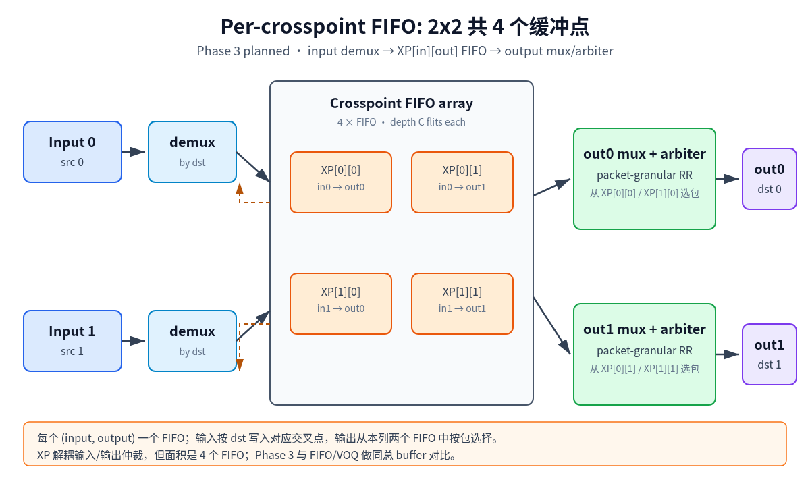

# Phase 3 — Per-crosspoint FIFO (XP) vs IQ-FIFO / IQ-VOQ

> 日期：2026-11-03
> 实验目录：`experiment/1-2x2-crossbar-fifo-vs-voq`
> Phase 1 报告：[../REPORT.md](../REPORT.md)
> Phase 2 报告：[phase2.md](phase2.md)
> 数据与绘图数据：[../results/phase3/](../results/phase3/)
> 结构图：[../docs/figures/xp-architecture.png](../docs/figures/xp-architecture.png)

## 0. 结论速览

- Phase 3 core matrix 共 **144 runs**（`fifo` / `voq` / `xp` × 4 capacity ×
  4 load × 3 seeds），**144/144 exact**：逐包 `(src, len, start, end)` 和
  逐 cycle 调试字段全部相等，没有统计容差。
- XP 与 VOQ 在 **16/16 cell、48/48 seed-pair** 上所有模型指标完全相同；
  两套独立 RTL 的逐包/逐 cycle CSV 也全部相等。
- 等每队列深度时，XP/VOQ 相对 FIFO 的利用率增益随容量增加：
  cap 4/8/16/32 为 **+1.87 / +4.64 / +6.31 / +6.85pp**。但这个口径下
  XP/VOQ 的总 buffer 是 FIFO 的 **2 倍**，不能直接算“结构赢”。
- 等总 buffer 时，XP 相对 FIFO 的平均增益为：
  16 flits **+0.58pp**、32 flits **+3.99pp**、64 flits **+6.61pp**。
  16-flit 点收益很小，说明浅缓冲下 per-destination 分割的容量损失会吃掉
  no-HOL 的收益；32/64-flit 点才明显。
- load 0.5 基本持平；等每队列容量口径下，load 0.8/0.95/1.0 的平均增益为
  **+5.82 / +6.62 / +7.25pp**。
- 关键结论：在 **XP-only + 2x2 + 源端单 outstanding packet** 的配置下，
  XP 与当前 IQ-VOQ 的可观测行为等价。两者都是 4 个 per-(src,dst) 队列；
  XP 不是本轮的新吞吐机制，而是同一组队列的物理放置方式。选择 XP 与
  VOQ 应看面积、时序、floorplan 和扩展方式，而不是本轮吞吐差异。

## 1. 问题

Phase 1 已经确认共享 input FIFO 的 HOL blocking 会显著限制高负载吞吐；
Phase 2 把 per-queue capacity 变成正交变量，确认 VOQ 的收益随容量、负载、
包长分布变化。

Phase 3 要回答三个问题：

1. 实现 per-crosspoint FIFO（XP）后，模型与 RTL 是否还能做到逐包、逐 cycle
   精确一致？
2. XP 与已有 IQ-VOQ 在相同 trace、相同仲裁策略、相同每队列深度下是否真的
   有吞吐/延迟差异？
3. 与 IQ-FIFO 比较时，按等总 buffer 而不是“多给一倍存储”，XP 的收益还剩多少？

一个必须先说清的语义点：本实验的 IQ-VOQ 参考实现已经是“每个
(input, output) 一个队列，输入按 dst 写入，输出从本列两个队列中选包”。
这在 2x2、源端一次只持有一个 packet 的条件下，与 XP-only 的可观测行为相同。
Phase 3 不假设这一点，而是用独立 RTL/TB 和逐包/逐 cycle 比较来验证它。

## 2. XP 结构

XP 在 2x2 中共 4 个 crosspoint FIFO：`XP[src][dst]`，其中
`src ∈ {0,1}`、`dst ∈ {0,1}`。



- 输入 demux：按当前包的 `dst` 把 flit 写入 `XP[src][dst]`。
- 输出 mux/arbiter：输出 `dst` 从 `XP[0][dst]` 与 `XP[1][dst]` 中按包粒度
  选包；grant 后锁定到 EOP。
- 不丢包：目标 XP FIFO 满时拉低该输入的 `in_rdy`，源端保持 `vld` 和当前
  packet，不切换目的。
- XP-only 不另设 input queue：源端一次只有一个 outstanding packet，每 cycle
  写 1 个 flit，包尾后有一个 load turnaround。
- 每个 XP FIFO 存 `{sop, eop, data}`；`dst` 由 FIFO 下标隐式表示。

结构图不重画，直接使用已有的
[`xp-architecture.svg`](../docs/figures/xp-architecture.svg) /
[`xp-architecture.png`](../docs/figures/xp-architecture.png)。

### 2.1 为什么 XP-only 与当前 IQ-VOQ 等价

当前 VOQ 实现的 4 个队列是 `voq[src][dst]`，输入 demux 按 `dst` 写入，
输出从本列两个 VOQ 中按包粒度仲裁；源端同样一次只持有一个 packet。
XP 只是把这 4 个队列放到 crosspoint 位置，读写端口和仲裁时序相同。因此：

- 在同一 trace、同一 capacity、同一 RR 策略下，两者的逐包完成顺序和逐 cycle
  状态应完全一致。
- 差异在于物理位置、布线、面积和可扩展性，而不是本轮 2x2 的吞吐。
- 若要观察 XP 的独立收益，需要加入 XP+VOQ 两层队列、input scheduling、
  多 packet outstanding 或输出反压；这些不在本轮范围。

## 3. 变量与控制

### 3.1 自变量

| 维度 | 取值 |
|---|---|
| queue type | `fifo` / `voq` / `xp` |
| capacity per queue | 4 / 8 / 16 / 32 flits |
| load（per-input offered flit rate） | 0.5 / 0.8 / 0.95 / 1.0 |
| packet length | `uniform1-8`（uniform integer 1–8） |
| traffic | `uniform` destination |
| seed | 1 / 2 / 3 |

规模：`3 × 4 × 4 × 3 = 144` runs。

### 3.2 固定条件

- 2 inputs / 2 outputs；每输入每 cycle 最多 1 flit，每输出每 cycle 1 flit。
- packet-granular arbitration，整包锁定 input/output 到 EOP。
- no-drop：队列满只反压，不丢包。
- 每输出 round-robin；output 0 在冲突时优先，output 1 的请求避让。
- 下游始终 ready（`out_rdy = 2'b11`），本阶段不注入输出反压。
- 4000 cycles，前 500 cycles warmup；指标按后 3500 cycles 统计。
- 模型和 RTL 读取完全相同的 `trace.jsonl` / `trace.csv`。

### 3.3 容量口径

| 结构 | 队列数 | 总 buffer |
|---|---|---|
| FIFO | 2 | `2 × C_fifo` |
| VOQ | 4 | `4 × C_voq` |
| XP | 4 | `4 × C_xp` |

- XP 与 VOQ 等每队列深度时，总 buffer 相同。
- 与 FIFO 做等总 buffer 比较时，使用 `C_4q = C_fifo / 2`：
  FIFO 8/16/32 对 XP/VOQ 4/8/16，总容量 16/32/64 flits。
- 等总 buffer 的 8-flit 点（FIFO 4 vs 4-queue 2）和 128-flit 点
  （FIFO 64 vs 4-queue 32）不在本轮 grid 内，明确列为 uncovered。
- 本轮同时报告“等每队列深度”和“等总 buffer”两组结果；结论以等总 buffer
  为主，避免用多一倍存储赢。

### 3.4 Source ceiling

源端一次只有一个 outstanding packet，包长均值 4.5 flits，所以每个 input 的
长期可持续 flit rate 上限为：

```text
source_ceiling = E[L] / (E[L] + 1) = 4.5 / 5.5 = 0.818
```

因此 load 0.95 / 1.0 是 **source-saturated** 点：吞吐上限由源端契约和
反压决定，不应解读为 crossbar 的原始容量。load 0.8 刚好在 ceiling 以下，
是本轮最有信息量的高负载点。

## 4. 实现

### 4.1 RTL / TB

新增：

- `rtl/xbar_2x2_xp.sv`
  - 4 个 `fifo_sync` crosspoint FIFO，数据宽度 `FLIT_W + 2`。
  - 输入 demux、输出 mux、packet-granular RR、EOP lock。
  - 控制状态用 `dffr`，FIFO 存储体由 CBB 内部 `dff` 实现；业务模块没有
    裸 `always_ff`。
  - 端口先预处理为内部信号，实例端口只连信号名。
- `tb/xbar_2x2_xp_tb.sv`
  - 同一套 trace replay、packets CSV、逐 cycle 调试 CSV。
  - 顶层参数 `DEPTH`，编译时通过 `-P xbar_2x2_xp_tb.DEPTH=C` 覆盖。
- `sva/xbar_2x2_xp.sva`
  - 输出 stable / sop/eop marker 断言；iverilog 不支持并发断言，本阶段未编译
    执行，只做静态交付。
- `scripts/model_v2.py`
  - 新增 `xp` mode；复用同一套 flit 粒度、show-ahead、start-of-cycle
    occupancy 和 packet-lock 时序。
- `scripts/run_cosim.py`
  - 新增 `xp` DUT/TB 映射和 co-sim 支持。
- `scripts/run_phase3.py`
  - Phase 3 core matrix 驱动；每个 `(type, capacity)` 编译一次。
- `scripts/analyze_phase3.py`
  - 配对 delta、等总 buffer 重提取、XP/VOQ 等价汇总。
- `scripts/compare_xp_voq.py`
  - XP RTL 与 VOQ RTL 的逐包/逐 cycle CSV 相等检查。

### 4.2 RTL 规范检查

- `quality_gate.py rtl/xbar_2x2_xp.sv`：20 项检查全部 PASS，0 error、0 warning。
- `align.sh rtl/xbar_2x2_xp.sv`：已执行，交付文件为对齐后的版本。
- 状态/控制：`locked` / `locked_src` 用 `dffr`，有显式 `en`。
- 数据通路：FIFO 存储体、`sop/eop/data` 不复位，由 CBB 内部 `dff` 实现。
- `.sva` 独立文件，不在 `.sv` 内写断言。

### 4.3 编译与运行

每个 `(queue, capacity)` 只编译一次：

```text
build/phase3/{fifo,voq,xp}_c{4,8,16,32}
```

所有 load / seed 复用同一 binary。中间 per-packet / per-cycle CSV 放在
`~/Temp/phase3/`，比较完成后删除；提交的只有聚合 JSON/CSV。

## 5. 验证

### 5.1 Exact 标准

每次 run 同时执行 Python cycle model 和 RTL：

1. **逐包**：按输出端口、按完成顺序比较 `(src, len, start, end)`；
   数量和字段任一不一致即失败。
2. **逐 cycle**：比较每个 cycle 的：
   - source `vld / wr / stall / flit index`
   - 每个 per-dst queue 的 occupancy / valid
   - 每个 output 的 `src / vld / sop / eop / grant / locked / locked_src`

不使用统计容差。144 runs × 4000 cycles = 576,000 个 cycle 比较点。

### 5.2 覆盖

- Core matrix：144/144 exact；48 cells；48 paired strata（3 个 pair 各 16）。
- XP/VOQ 模型指标等价：16/16 cells，48/48 seed-pairs 完全相同。
- 定向验证：复用 Phase 1 的 27 个 directed cases（单包四组合、同目的冲突
  1/1、8/1、1/8、8/8、错拍冲突、打满、HOL、RR 压力、背靠背到达）。
- XP/VOQ RTL 等价检查：27 directed + 4 random traces × depth 4/8/16/32，
  共 124 个 `(trace, depth)` 组合；XP 和 VOQ 各自先与模型 exact，再比较两套
  RTL 的 packets CSV 和 cycles CSV。
- 所有比较均通过，无 mismatch。

### 5.3 未覆盖

- 下游 `out_rdy` 反压：TB 固定 `out_rdy=2'b11`。
- XP+VOQ 两层队列、input scheduling、多 outstanding packet。
- OQ / CIOQ。
- 面积/时序综合；本报告只按 flit 数计存储，不把 FIFO 控制、mux、布线和
  时钟树成本折算成门数或 μm²。

## 6. 结果

### 6.1 利用率矩阵

FIFO（等每队列容量 C，总 buffer 2C）：

| FIFO cap | load 0.5 | 0.8 | 0.95 | 1.0 |
|---|---|---|---|---|
| 4 | 0.489 | 0.693 | 0.701 | 0.691 |
| 8 | 0.489 | 0.709 | 0.716 | 0.712 |
| 16 | 0.489 | 0.716 | 0.730 | 0.717 |
| 32 | 0.489 | 0.716 | 0.718 | 0.716 |

XP（等每队列容量 C，总 buffer 4C；VOQ 逐项相同）：

| XP cap | load 0.5 | 0.8 | 0.95 | 1.0 |
|---|---|---|---|---|
| 4 | 0.489 | 0.720 | 0.719 | 0.720 |
| 8 | 0.489 | 0.767 | 0.780 | 0.775 |
| 16 | 0.489 | 0.789 | 0.813 | 0.813 |
| 32 | 0.489 | 0.790 | 0.817 | 0.817 |

观察：

- load 0.5 时所有结构都跟上 offered load，利用率约 0.489，结构差异消失。
- FIFO 在高负载被 HOL 卡在约 0.69–0.73；XP/VOQ 随容量增加升到约
  0.79–0.82。
- load 0.95 / 1.0 接近 source ceiling，VOQ/XP 也只能到 0.82 左右；这不是
  crossbar 的绝对上限。
- XP 的 HOL rate 恒为 0；FIFO 的 HOL rate 随容量和负载变化（约 0.01–0.47）。
- XP 延迟随容量增加明显下降：cap 4 → 32 在 load 0.8 时从 237.5 降到
  70.8 cycles。

### 6.2 等每队列深度：XP/VOQ vs FIFO

| capacity | Δutilization（XP−FIFO） | Δavg latency | Δp99 latency |
|---|---|---|---|
| 4 | +1.87pp | −44.3 | −73.9 |
| 8 | +4.64pp | −103.5 | −178.1 |
| 16 | +6.31pp | −135.1 | −239.1 |
| 32 | +6.85pp | −141.1 | −264.3 |

按 load：

| load | Δutilization（XP−FIFO） | Δavg latency |
|---|---|---|
| 0.5 | −0.03pp | −0.4 |
| 0.8 | +5.82pp | −135.9 |
| 0.95 | +6.62pp | −143.7 |
| 1.0 | +7.25pp | −143.9 |

这个口径下 XP 的总 buffer 是 FIFO 的 2 倍，因此只能说明“容量更多 + no-HOL”
的联合效果，不能把全部增益归因于队列结构。

### 6.3 等总 buffer：XP vs FIFO

主比较，等总 flit 数：

| 总 buffer | FIFO cap | XP cap | FIFO util（4 load 均值） | XP util | Δutilization | Δavg latency | Δp99 latency |
|---|---|---|---|---|---|---|---|
| 16 | 8 | 4 | 0.6562 | 0.6621 | **+0.58pp** | −7.6 | −21.4 |
| 32 | 16 | 8 | 0.6627 | 0.7027 | **+3.99pp** | −91.3 | −149.7 |
| 64 | 32 | 16 | 0.6598 | 0.7259 | **+6.61pp** | −134.5 | −255.7 |

- 16-flit 点：XP 仅在 load 0.8/0.95/1.0 有小幅优势（+1.14/+0.35/+0.85pp），
  load 0.5 完全持平；平均 +0.58pp，实际意义很弱。
- 32-flit 点：高负载收益约 +5.0–5.9pp。
- 64-flit 点：高负载收益约 +7.3–9.6pp。
- 等总 buffer 下，XP 的收益来自 no-HOL，但浅缓冲时 4 个 per-destination
  队列的容量分割会抵消一部分收益。

### 6.4 XP vs VOQ

- 模型指标：16/16 cell、48/48 seed-pair 全部完全相同；所有 delta 为 0。
- RTL：124/124 个 `(trace, depth)` 组合中，XP 和 VOQ 各自与模型 exact，
  两套 RTL 的 packets CSV 与 cycles CSV 逐字段相等。
- 结论：在当前 XP-only、2x2、单 outstanding source 的配置下，XP 与 IQ-VOQ
  不是两个不同的吞吐方案，而是同一组 4 队列的两种物理实现。

## 7. 结论

1. XP 实现是 exact 的：core matrix 144/144、directed + random RTL 等价检查
   124/124，均无逐包或逐 cycle 差异。
2. XP-only 与当前 IQ-VOQ 在本实验条件下行为等价。若目标是吞吐/延迟，XP 不会
   比 VOQ 更好；若目标是 crosspoint 局部缓冲、floorplan 或后续 XP+VOQ 分层，
   XP 才有独立意义。
3. 对 FIFO 的比较必须以等总 buffer 为主：
   - 16 flits：+0.58pp，基本可以视为持平；
   - 32 flits：+3.99pp；
   - 64 flits：+6.61pp。
   浅缓冲下不要期待 XP 明显赢；深缓冲 + 高负载才是 XP/VOQ 的收益区间。
4. load 0.5 时所有结构都跟上 offered load，没有结构差异；高负载收益明显，
   但 load 0.95/1.0 已进入 source-saturated 区间，结论应理解为反压下的行为。
5. 本实验没有证明 XP 在面积/时序上优于 VOQ。4 个 FIFO 的控制、mux 和布线
   成本需要后续用综合或明确的门数模型评估。

## 8. 限制

- 下游始终 ready，没有验证输出反压路径；XP 的 `out_rdy -> XP FIFO 反压`
  路径尚未在 co-sim 中注入 stall。
- 只有 2x2、uniform destination、`uniform1-8`、3 seeds；没有在 Phase 3 重跑
  fixed1 / fixed8 / bimodal / hotspot / bursty。Phase 2 已有 FIFO/VOQ 的这些
  维度，但没有 XP。
- XP-only 没有 input queue；不支持多 outstanding packet，也没有 input
  scheduler。XP+VOQ 未实现。
- 没有 OQ / CIOQ；没有输出队列对下游突发的吸收。
- 存储只按 flit 数计；没有综合面积、SRAM/寄存器 bit 数、mux 扇出、关键路径
  或功耗数据。
- RTL packets CSV 仍没有显式 `seq`；包身份靠“每输入保序 + 每端口完成顺序 +
  逐 cycle 比较”确定。
- `.sva` 因 iverilog 不支持并发断言而未编译执行。
- 等总 buffer 的 8-flit 和 128-flit 端点未覆盖（grid 外），见
  `results/phase3/summary.json` 的 `equal_buffer.uncovered`。

## 9. 复现

依赖：Python 3.10+、iverilog 11+。所有命令从实验目录运行。

```bash
# 1. core matrix（144 runs）
python3 scripts/run_phase3.py \
  --workdir ~/Temp/phase3 \
  --outdir results/phase3

# 2. 定向 trace（27 cases）
python3 scripts/gen_directed.py --outdir ~/Temp/phase3_directed --cycles 1200

# 3. random traces（可选，用于 XP/VOQ RTL 等价检查）
for L in 0.5 0.8 0.95 1.0; do
  python3 scripts/gen_trace.py \
    --out ~/Temp/phase3_directed/random_l${L}_s1.jsonl \
    --csv-out ~/Temp/phase3_directed/random_l${L}_s1.csv \
    --load $L --cycles 2000 --seed 1 \
    --length-mode uniform1-8 --traffic uniform
done

# 4. XP vs VOQ RTL 逐包/逐 cycle 等价检查
python3 scripts/compare_xp_voq.py \
  --traces-dir ~/Temp/phase3_directed \
  --depths 4,8,16,32 \
  --cycles 2200 \
  --workdir ~/Temp/phase3_equiv \
  --out results/phase3/xp_voq_rtl_equivalence.json
```

RTL 自检：

```bash
python3 /root/.claude/skills/rtl-developer/scripts/quality_gate.py \
  rtl/xbar_2x2_xp.sv
/root/.claude/skills/rtl-developer/scripts/align.sh rtl/xbar_2x2_xp.sv
```

单次 XP co-sim：

```bash
python3 scripts/run_cosim.py \
  --trace-jsonl ~/Temp/phase3/traces/l0.8_uniform1-8_uniform_s1.jsonl \
  --trace-csv ~/Temp/phase3/traces/l0.8_uniform1-8_uniform_s1.csv \
  --cycles 4000 --warmup 500 \
  --dut xp --mode xp --depth 8 --compile \
  --binary build/phase3/xp_c8 \
  --outdir /tmp/cosim_xp
```
