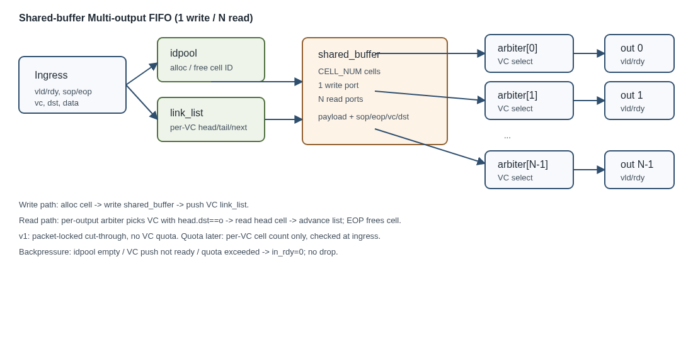

# 2 — Shared-buffer Multi-output FIFO

> 状态：**架构（C0/E0）+ E1 cycle model + E2 集成 RTL + 逐包逐 cycle co-sim（cell16/32/64、VC2/4、100%/75% ready 全部 exact）**
> 目标：为 NoC 的 1-write / N-read 共享缓冲 FIFO 定义可实现的 CBB 组合与
> 集成契约；第一版不做 VC quota，后续 quota 只按 VC 计，不按 output 计。

## 范围

- 1 个写端口，N 个独立读端口；cell-based 共享存储。
- 包粒度 cut-through：输出在 SOP 锁定到 EOP；flit 级传输，不缓存整包。
- no-drop：cell 池耗尽或目标队列满时反压写侧。
- 输入支持 `sop/eop/vc/dst`；输出按 `dst` 选择可服务的 VC。
- CBB 源码在 `ttoms/cbb_proj`；本实验只引用/固定版本，不在 NOC 内改 CBB。

## 组件

- `idpool`：cell ID 分配/回收。
- `link_list`：每 VC 的 cell 链，维护 head/tail/next。
- `shared_buffer`：1W N R cell 存储。
- `mo_fifo_top`：上述三件 + 每输出 VC 仲裁 + 反压/配额钩子。
- `xbar_2x2_shared`：NOC 集成层，两个 `mo_fifo_top` + 每输出 2:1 RR/包锁。

## 文档

- [架构与接口](docs/architecture.md)
- [E1 计划与口径](docs/e1-plan.md)
- [E1 模型与 2x2 对比报告](reports/e1_shared_fifo.md)
- [E2 2x2 集成 RTL 与定向 TB](docs/e2-integration.md)
- [E2 RTL/model co-sim 报告](reports/e2_cosim.md)
- 集成 RTL：[rtl/xbar_2x2_shared.sv](rtl/xbar_2x2_shared.sv)
- CBB 依赖与固定版本：[vendor/cbb/README.md](vendor/cbb/README.md)

## 非目标（v1）

- 不做 VC quota（只保留端口/钩子）。
- 不做 wormhole 的 flit 级跨包交织；先做 packet-locked cut-through。
- 不做多写端口、跨时钟域、ECC、动态 cell 大小。
