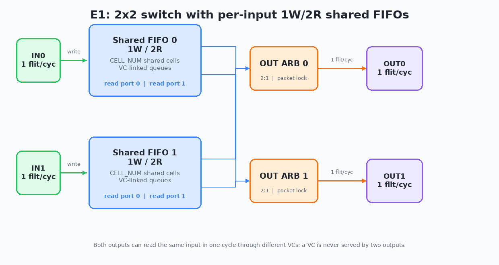

# E1 — 共享缓冲多输出 FIFO 的 cycle model 与 2x2 对比

> 日期：2026-11-04
> 状态：模型 + 对比报告完成；**本阶段没有 RTL**
> 计划与口径：[../docs/e1-plan.md](../docs/e1-plan.md)
> 原始数据：[../results/e1/](../results/e1/)、[../results/e1_multi4/](../results/e1_multi4/)、
> [../results/e1_scf/](../results/e1_scf/)、[../results/e1_backpressure/](../results/e1_backpressure/)、
> [../results/e1_hotspot/](../results/e1_hotspot/)

## 1. 结论

1. **低负载下共享池没有收益。** load=0.8 时所有架构利用率都在 80.1–80.4%，
   per_dst 与 VOQ 的差在 ±0.5pp 内；瓶颈不在缓冲组织。
2. **VC 与目的地分离（per_dst）时，共享池 + 双读口在高负载下明显提升吞吐。**
   相对实验 1 的 VOQ 基线，load≥0.95 时：
   - cap16：+5.69pp（0.95）、+5.97pp（1.0）
   - cap32：+3.58pp（0.95）、+4.86pp（1.0）
   - cap64：+1.39pp（0.95）、+2.77pp（1.0）
   全矩阵平均 +2.71pp；高负载（≥0.95）平均 +4.04pp。**增益随 buffer 变大而缩小**。
3. **VC 混载不同目的地（multi2）会毁掉收益，甚至反超为负。**
   相对 VOQ，load≥0.95 时 cap16 −3.77/−3.32pp、cap32 −7.00/−6.59pp、
   cap64 −9.80/−9.86pp；全矩阵平均 −4.58pp，高负载平均 −6.72pp。
   **buffer 越大，VC 内 HOL 越严重**，因为更多包堆在同一个被队头挡住的 VC 后面。
4. **per_dst vs multi2 是最大单项差异。**
   高负载下 +9.29～+12.63pp，平均 +10.77pp。也就是说：
   “VC 是否与目的地绑定”比“共享池 vs 独立队列”更重要。
5. **吞吐提升伴随尾延迟变差。** per_dst 相对 VOQ 的 admission 平均延迟在高负载
   多数场景高 1.6–4.3 cycles，p99 高 6.4–38.8 cycles；cap64/load1.0 的 p99
   从 84.2 升到 123.0。共享池允许更深排队，换来了吞吐，但不是低延迟方案。
6. **共享池不能解决输出口瓶颈。** hotspot（80% 流量到 output0）下三种架构
   吞吐都约 62.6%，per_dst 与 VOQ 差 −0.00pp；共享池只把排队变深，平均
   admission 延迟多 24.0 cycles。输出口打满时，共享池没有吞吐收益。
7. **多 VC 只能缓解、不能消除 VC 内 HOL。** multi4 相对 VOQ：cap16 +0.58/+0.78pp，
   cap32 −0.88/−1.38pp，cap64 −2.27/−4.27pp；比 multi2 好，但仍低于 per_dst，
   延迟仍高 5.6–29.4 cycles。
8. **同拍 alloc/free 的 idpool 优化收益很小。** per_dst 开启后，cap16/load1.0
   只多 +0.83pp，cap32 +0.18pp，cap64 约 0；值得实现，但不是决定性优化。
9. **输出反压（75% ready）下结论不变。** cap32/load1.0：per_dst 比 VOQ
   +3.45pp，multi2 比 VOQ −6.75pp；无死锁、无不变量失败。per_dst 延迟
   +14.45 cycles，multi2 +22.86 cycles。
10. **设计建议：v1 优先把 VC 绑定到目的地，或直接做 per-destination 队列。**
    如果必须允许一个 VC 混载多个目的地，应预期 3–10pp 吞吐损失和显著尾延迟；
    per-VC quota 只能限制单个 VC 占池，**不能解决 VC 内 HOL**。

## 2. 口径与公平性

### 2.1 拓扑



- 完整 2x2 交换机，2 输入 / 2 输出。
- 每个输入一个 `mo_fifo_top`：1 写口、2 读口、`CELL_NUM` 个共享 cell、
  `VC_NUM` 条 VC 链。两个实例的读口接到每输出 2:1 仲裁。
- 多 flit 包 SOP 后锁定 (input, vc)，EOP 释放；单 flit 包不进入多拍锁定。
- 共享 FIFO 的两个读口可以在同一拍分别服务两个输出；这是完整 1W2R 组件的能力。

### 2.2 与实验 1 VOQ 的对齐

- 基线：实验 1 `model_v2.py` 的 `voq` 模式，完整 2x2、每输入每目的一个队列。
- **等总 buffer**：共享每输入 `CELL_NUM`，整机 `2×CELL_NUM`；VOQ 每队列
  `CELL_NUM/2`，整机 `2 输入 × 2 目的 × CELL_NUM/2 = 2×CELL_NUM`。
- **读口数不对齐，必须明确**：共享 FIFO 每输入最多 2 读/拍，VOQ 基线每输入
  1 读/拍。因此本文的“共享 vs VOQ”差异**同时包含端口数优势**，不能单独
  归因于 cell 池共享。要拆开这两个因素，需要等端口数的 VOQ（每输入 2 读/拍）
  基线，本阶段未做。
- 相同的 trace：包到达、目的、包长完全一致；共享侧只额外派生 `vc` 字段，
  VOQ 忽略该字段。`SOURCE_GAP=0`。
- 4000 cycles，warmup 500；seeds 1–5；5-seed 配对 95% t CI（df=4，t=2.776）。

### 2.3 VC 配置

- `per_dst`：`VC_NUM=2`，`vc=dst`；每个 VC 只承载一个目的地，无 VC 内 HOL。
- `multi2`：`VC_NUM=2`，`vc` 与 `dst` 独立随机；一个 VC 可混载两个目的地。
- `multi4`（扩展）：`VC_NUM=4`，`vc` 随机；更多 VC，但仍允许混载。

### 2.4 模型约定

- 源：每输入最多 1 个 outstanding packet；包在 `arrival` 拍载入，下一拍写第一个
  flit；背靠背包在最后一个 flit 的边沿载入下一个已到达包。
- 写侧：主矩阵在拍首看共享池是否有空 cell；本拍读释放的 cell 不用于本拍写，
  与实验 1 的 `fifo_sync` 起始占用口径一致。`same-cycle-free` 作为扩展单独测。
- 读侧：拍首看到的 head 参与仲裁；写在拍尾提交，下一拍可见。
- 输出：每输出在“head.dst==o 且未被其他输出锁定”的 VC 中做 RR；
  输出锁定后只服务该 (input, vc) 到 EOP。
- 不丢包：池满只反压写侧；cell 只在读握手后释放。

## 3. 主矩阵结果

### 3.1 利用率（5 seeds，均值 ±95% CI）

| cap | load | VOQ | per_dst | multi2 |
|---:|---:|---:|---:|---:|
| 16 | 0.80 | 80.13±2.37% | 80.32±2.20% | 79.67±1.84% |
| 16 | 0.95 | 84.29±1.98% | **89.99±2.40%** | 80.53±1.80% |
| 16 | 1.00 | 83.92±1.21% | **89.88±1.91%** | 80.60±1.21% |
| 32 | 0.80 | 80.36±2.21% | 80.36±2.22% | 80.15±2.15% |
| 32 | 0.95 | 89.38±1.95% | **92.96±1.64%** | 82.38±1.61% |
| 32 | 1.00 | 89.42±1.70% | **94.28±1.33%** | 82.83±1.93% |
| 64 | 0.80 | 80.41±2.23% | 80.36±2.22% | 80.19±2.35% |
| 64 | 0.95 | 92.76±1.45% | **94.15±1.63%** | 82.96±1.42% |
| 64 | 1.00 | 93.44±1.48% | **96.21±0.95%** | 83.58±1.15% |

### 3.2 配对差值（共享 − VOQ，5 seeds，均值 ±95% CI）

| cap | load | per_dst − VOQ | multi2 − VOQ | per_dst − multi2 |
|---:|---:|---:|---:|---:|
| 16 | 0.80 | +0.19±0.48pp | −0.46±0.98pp | +0.65±0.56pp |
| 16 | 0.95 | **+5.69±1.06pp** | −3.77±0.91pp | **+9.46±1.46pp** |
| 16 | 1.00 | **+5.97±1.52pp** | −3.32±1.51pp | **+9.29±2.08pp** |
| 32 | 0.80 | −0.00±0.16pp | −0.21±0.43pp | +0.21±0.33pp |
| 32 | 0.95 | **+3.58±1.26pp** | −7.00±1.73pp | **+10.58±2.33pp** |
| 32 | 1.00 | **+4.86±1.13pp** | −6.59±2.91pp | **+11.46±1.89pp** |
| 64 | 0.80 | −0.05±0.10pp | −0.21±0.32pp | +0.17±0.27pp |
| 64 | 0.95 | +1.39±1.15pp | −9.80±1.44pp | **+11.19±2.24pp** |
| 64 | 1.00 | +2.77±1.02pp | −9.86±1.41pp | **+12.63±1.29pp** |

聚合：per_dst − VOQ 全矩阵 +2.71pp，高负载平均 +4.04pp；
multi2 − VOQ 全矩阵 −4.58pp，高负载平均 −6.72pp；
per_dst − multi2 全矩阵 +7.29pp，高负载平均 +10.77pp。

### 3.3 延迟与占用

- per_dst 相对 VOQ 的 admission 平均延迟：高负载多数场景 +1.6～+4.3 cycles；
  cap64/0.95 为 −6.5±5.5 cycles（CI 很大，不当作结论）；cap32/0.80 为 −3.7 cycles。
- per_dst 的 p99 admission 延迟在高负载 +6.4～+38.8 cycles；
  cap64/1.0 为 123.0 vs 84.2 cycles。**吞吐换尾延迟**。
- multi2 相对 VOQ：平均 admission +6.3～+40.7 cycles，p99 +17.6～+79.8 cycles。
- 池占用（每输入平均）：
  - per_dst cap16/0.95 = 0.663，cap64/0.95 = 0.332；
  - multi2 cap16/0.95 = 0.837，cap64/0.95 = 0.893。
  - 同等吞吐下，multi2 把池子填满在“被队头挡住的包”上；per_dst 的池占用更低。
- 源端 stall rate：
  - per_dst cap64/0.95 = 0.005；multi2 cap64/0.95 = 0.149。
  - 池大并不自动降低 stall；VC 内 HOL 会让写侧持续反压。
- 双读周期率（每拍有多少比例发生同一输入两读）：
  - per_dst load0.8/0.95/1.0 约 0.25/0.38～0.43/0.38～0.46；
  - multi2 约 0.18～0.24。
  - 说明 2 读口在 per_dst 下被实际利用；multi2 因 HOL 无法充分利用。
- 输入/输出 Jain 指数：主矩阵均匀流量下约 0.999；没有观察到饥饿。

## 4. 扩展实验

### 4.1 multi4（更多 VC 是否缓解 HOL）

cap16/32/64，load0.95/1.0，5 seeds，相对 VOQ：

| cap | load | multi4 − VOQ 利用率 | admission 延迟差 |
|---:|---:|---:|---:|
| 16 | 0.95 | +0.58±1.49pp | +5.59±0.69 |
| 16 | 1.00 | +0.78±1.27pp | +5.80±0.17 |
| 32 | 0.95 | −0.88±1.07pp | +11.09±1.29 |
| 32 | 1.00 | −1.38±1.38pp | +12.64±1.16 |
| 64 | 0.95 | −2.27±1.28pp | +21.92±7.78 |
| 64 | 1.00 | −4.27±1.23pp | +29.36±2.61 |

multi4 比 multi2 好（例如 cap64/1.0 从 −9.86pp 收窄到 −4.27pp），但仍低于
per_dst，也低于 VOQ（cap32/64 高负载）；延迟仍显著更差。**增加 VC 数量只是
降低混载概率，不改变“同一 VC 内后包被前包挡住”的机制。**

### 4.2 同拍 alloc/free（idpool 扩展）

per_dst，`same_cycle_free=True` 相对主矩阵：

| cap | load | 利用率增量 | admission 增量 |
|---:|---:|---:|---:|
| 16 | 0.95 | +0.42pp | +0.20 |
| 16 | 1.00 | +0.83pp | +0.28 |
| 32 | 0.95 | +0.09pp | +0.07 |
| 32 | 1.00 | +0.18pp | +0.38 |
| 64 | 0.95 | +0.02pp | +0.25 |
| 64 | 1.00 | +0.01pp | +0.21 |

小池 + 高负载时有 0.4–0.8pp 收益；大池几乎为 0。实现同拍 alloc/free 是合理的，
但它不是共享池的主要收益来源。

### 4.3 输出反压

cap32、load1.0、`out_rdy` 周期 8 拍高 6 拍（75% ready），5 seeds：

| 架构 | 利用率 | admission 延迟 |
|---|---:|---:|
| VOQ | 68.41±0.71% | 31.36±0.54 |
| shared per_dst | **71.86±1.05%** | 45.81±0.39 |
| shared multi2 | 61.65±1.42% | 54.22±1.46 |

相对 VOQ：per_dst +3.45±0.84pp，multi2 −6.75±1.04pp。无死锁、无不变量失败。
输出反压不改变主结论，但会放大 per_dst 的排队延迟。

### 4.4 Hotspot 流量

cap32、load0.95、80% 包到 output0，5 seeds：

| 架构 | 利用率 | admission 延迟 |
|---|---:|---:|
| VOQ | 62.60±1.12% | 28.63±0.49 |
| shared per_dst | 62.59±1.14% | 52.64±0.85 |
| shared multi2 | 62.26±0.99% | 53.46±1.03 |

三种架构吞吐几乎相同：输出口是瓶颈，共享池不能创造带宽。共享侧只把排队加深，
平均 admission 延迟多约 24 cycles。**如果目标是 hotspot 下的低延迟，VOQ 更好；
共享池适合吸收突发/多输出并发，不适合单输出饱和场景。**

## 5. 正确性与验证

- 主矩阵 90 个 shared runs，每个 run 4001 次不变量检查（每拍 + 结束），
  全部通过；没有 cell 泄漏、重复释放、VC 链断裂、输出锁不一致或 flit 序号跳变。
- 关键不变量：
  - `free + Σ|VC 链| == CELL_NUM`；
  - cell ID 分区、无重复、无泄漏；
  - VC 链内 flit 序号连续、包边界不交错；
  - 输出锁定的 VC 属于该输入，同一 VC 不被两个输出锁定；
  - 输出 flit 连续；非 SOP 只能出现在锁定输出；EOP 必须等于包长−1；
  - `lifetime_alloc − lifetime_free == 当前占用`。
- 定向测试覆盖：单 flit、多 flit、双输出并发读、池满反压、单 VC 多目的地 HOL、
  输出反压、随机 trace、per_dst/multi2 两种 VC 模式。
- VOQ 基线复用实验 1 已修正并验证过的 `model_v2.py`；本阶段没有对 VOQ 侧
  重复跑 E1 的不变量检查。

## 6. 限制

1. **端口数混杂**：共享 2 读/拍，VOQ 1 读/拍；本文的吞吐差同时包含端口数优势。
   要单独量化“共享 cell 池”的贡献，需要等端口数的 VOQ 基线（每输入 2 读/拍）。
2. **规模**：只做 2x2、N=2；没有 4x4、N=4、多级 NoC。
3. **流量**：主矩阵 uniform1-8 + uniform；扩展只做了 hotspot；没有 bursty、
   fixed1、fixed8、非均匀包长组合。
4. **源模型**：每输入最多 1 个 outstanding packet；不是多流并发源。
5. **输出 ready**：主矩阵 100%；反压只覆盖一个 75% ready 配置。
6. **延迟口径**：arrival latency 在高负载不是稳态；本文主用 admission latency。
7. **同拍 alloc/free**：主矩阵关闭；扩展只覆盖 per_dst。
8. **无 RTL**：本阶段没有 RTL/model 逐 cycle 联仿、没有时序/面积数据。
9. **无 quota、无 wormhole 跨包交织、无多写口/CDC/ECC。**
10. **公平性**：均匀流量下 Jain≈0.999；hotspot 下输出本身不平衡，未做逐流公平性。

## 7. 对后续设计的含义

- **v1 决策（2026-11-04 用户确认）**：v1 采用 **multi-dst VC**，即一个 VC 可以
  混载多个目的地；E1 的 per_dst 数据作为对照，不作为 v1 默认。
- **代价预期**：multi2 相对 VOQ 在高负载下损失约 3.3–9.9pp，尾延迟显著上升；
  增加 VC 数只能缓解，不能消除。per-VC quota 不是解药，它限制占用，不改变
  队头阻塞。RTL 验证必须覆盖 multi-dst VC 的 HOL 行为和输出锁定。
- **如果后续要追求吞吐/低尾延迟**：再评估把 VC 绑定到目的地（`vc=dst`）或改用
  per-destination 队列；这是本实验中影响最大的设计选择，远大于 cell 池共享本身。
- **池大小**：不要只追求大池。VC 混载时，大池会放大 HOL 和尾延迟；per_dst 时，
  cap16 的边际吞吐收益最大，cap32/64 收益递减。
- **下一步 E2**：先实现 per_dst 的 `mo_fifo_top` RTL + 定向 TB，再做模型/RTL
  逐 cycle 联仿；同时补一个等端口数 VOQ 基线和 quota 关闭/开启对照。
  如果 RTL 资源允许，再评估 multi-dst VC 的 HOL 代价是否与模型一致。

## 8. 复现

```bash
cd experiment/2-shared-multi-output-fifo

# 主矩阵（135 runs，5 seeds）
python3 scripts/run_e1.py \
  --seeds 1,2,3,4,5 --cell-nums 16,32,64 --loads 0.8,0.95,1.0 \
  --vc-modes per_dst,multi2 \
  --workdir /root/Temp/e1 --outdir results/e1

python3 scripts/analyze_e1.py results/e1/raw_runs.json --outdir results/e1

# multi4 扩展
python3 scripts/run_e1.py \
  --seeds 1,2,3,4,5 --cell-nums 16,32,64 --loads 0.95,1.0 \
  --vc-modes multi4 \
  --workdir /root/Temp/e1_multi4 --outdir results/e1_multi4

# 同拍 alloc/free 扩展
python3 scripts/run_e1.py \
  --seeds 1,2,3,4,5 --cell-nums 16,32,64 --loads 0.95,1.0 \
  --vc-modes per_dst --same-cycle-free \
  --workdir /root/Temp/e1_scf --outdir results/e1_scf

# 输出反压扩展
python3 scripts/run_e1.py \
  --seeds 1,2,3,4,5 --cell-nums 32 --loads 1.0 \
  --vc-modes per_dst,multi2 --rdy-period 8 --rdy-high 6 \
  --workdir /root/Temp/e1_bp --outdir results/e1_backpressure

# hotspot 扩展
python3 scripts/run_e1.py \
  --seeds 1,2,3,4,5 --cell-nums 32 --loads 0.95 \
  --vc-modes per_dst,multi2 --traffic hotspot \
  --workdir /root/Temp/e1_hot --outdir results/e1_hotspot
```

## 9. 数据文件

- `results/e1/raw_runs.json`：135 runs（45 VOQ + 45 per_dst + 45 multi2）。
- `results/e1/summary.csv`：每架构/容量/负载的 5-seed 均值与 CI。
- `results/e1/paired.csv`：配对差值。
- `results/e1_multi4/`、`results/e1_scf/`、`results/e1_backpressure/`、
  `results/e1_hotspot/`：扩展实验原始数据与汇总。
